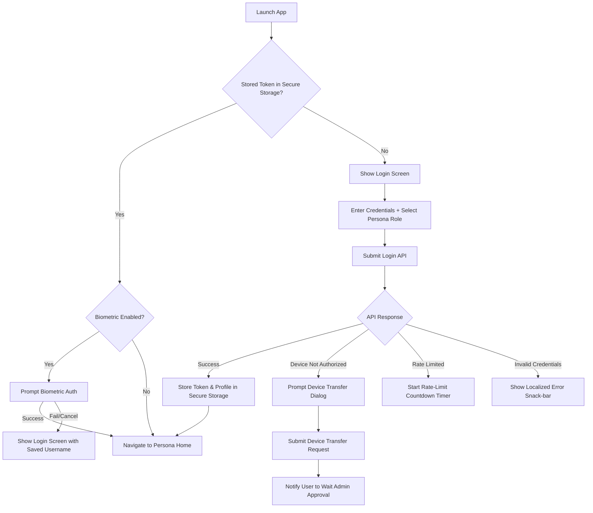
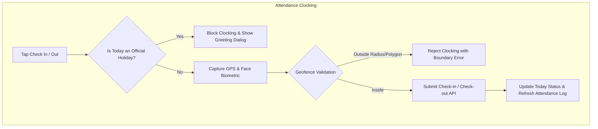
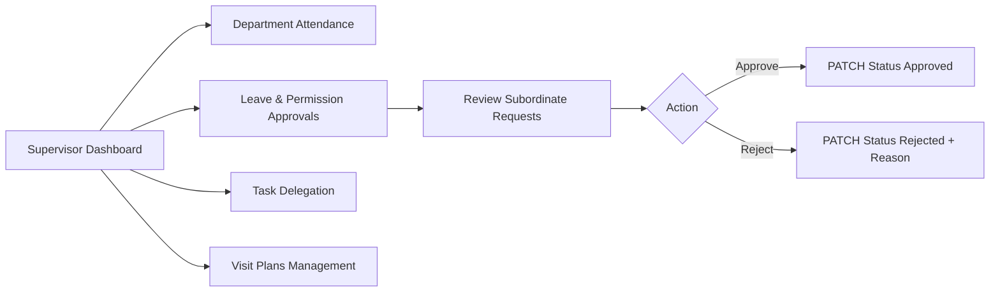
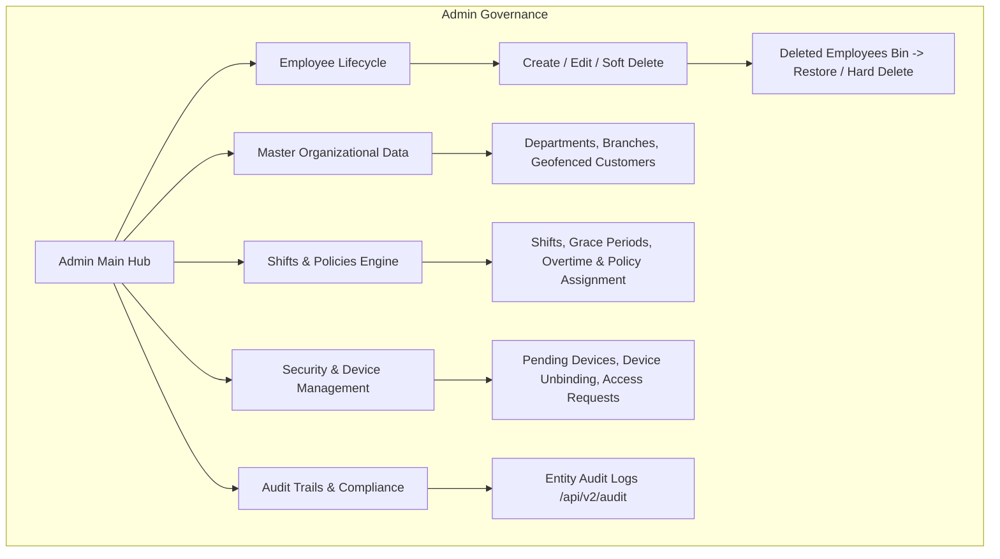
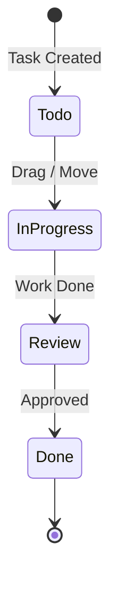

# Check Point HRM — Business Processes & Integration Test Specification
> **Document Purpose:** Comprehensive breakdown of all business logic, user flows, authorization matrices, data structures, and edge cases across the Check Point application to serve as the reference blueprint for Full End-to-End Integration Testing.

---

## 1. System Overview & Architecture Foundation

Check Point HRM is a multi-tenant / multi-role enterprise workforce management system supporting three primary personas:
1. **Admin (Enterprise Administrator):** Full system governance, organizational setup, master data, policy definitions, employee lifecycle, audit trails, and device binding.
2. **Supervisor (Team Lead / Department Manager):** Subordinate oversight, department attendance monitoring, plan creation, task delegation, and request approvals.
3. **Employee (Staff Member):** Daily attendance check-in/out with geofencing & biometric verification, leave/permission requests, task tracking, visit plans, and remote work requests.

### Core Technical Pillars:
- **Authentication & Security:** JWT Token-based auth, secure storage (`flutter_secure_storage`), Biometric Local Auth (`local_auth`), Device Binding via unique `mobileId`.
- **State Management:** `flutter_bloc` (Cubit) with `freezed` states and Dart 3 pattern matching.
- **Networking:** Dio + Retrofit mapped to `ApiResult<T>` with standard error interception and rate limiting.
- **Geofencing & Location:** Circle distance validation + Polygon ray-casting algorithm for strict office and customer geofence compliance.

---

## 2. Global Identity & Security Workflows

### 2.1 Login & Authentication Process
- **Input Parameters:** `userName`, `password`, `role` (`Admin` | `Supervisor` | `Employee`), `mobileId` (hardware/device identifier), `enableBiometricLogin` (boolean).
- **Process Steps:**
  1. User enters username and password, selects their operational persona role.
  2. The app fetches the hardware device unique identifier (`mobileId`).
  3. `LoginCubit` calls `LoginUseCase` which invokes `AuthApiService.login()`.
  4. **On Success:**
     - Store JWT Token, User ID, Username, Branch ID, and Selected Role into `AuthSessionStorage`.
     - If `enableBiometricLogin` is toggled ON, securely store biometric credentials / session.
     - Dismiss any pending registration state for this `mobileId`.
     - Route user directly to role shell:
       - `admin` $\rightarrow$ `/admin` (`AdminMainScreen`)
       - `supervisor` $\rightarrow$ `/supervisor` (`SupervisorMainScreen`)
       - `employee` $\rightarrow$ `/employee` (`EmployeeMainScreen`)
  5. **On Device Conflict (`errors.deviceLoginAccess`):**
     - Emits `LoginDeviceTransferRequired`.
     - Shows dialog prompting user to submit a **Device Transfer Request** to rebind their account to the new device.
  6. **On Rate Limit:**
     - Extracts retry wait seconds from error response.
     - Disables submit button and initiates countdown timer.

### 2.2 Device Binding & Transfer Process
- **Business Rule:** An employee can only log in from their designated registered device unless authorized by an Admin.
- **Flow:**
  1. When login fails with device authorization error, the user confirms device transfer request.
  2. App sends `POST /api/Auth/DeviceTransferRequest` with user credentials and new `mobileId`.
  3. Admin receives pending device binding under `/admin/pending-devices`.
  4. Admin can **Approve** (`POST /api/v2/employees/{id}/devices`) or **Reject** (`DELETE /api/v2/employees/{id}/devices/{deviceId}`).

### 2.3 New Account Access Request Process
- **Flow:**
  1. Unregistered user taps "Request Access" from login screen.
  2. Fills registration form: Name, Phone, Email, National ID, Department, Job Title, MobileId.
  3. App submits `POST /api/AccountRequest`.
  4. App polls/checks request status on login screen via `GET /api/AccountRequest/status?mobileId=...`.
  5. Shows dynamic badge on Login Screen: `Pending`, `Approved`, or `Rejected`.

---

## 3. Employee Domain Business Processes

### 3.1 Attendance & Clocking (Check In / Check Out)
- **Validation Constraints:**
  1. **Holiday Lock:** If the day is an official holiday or employee's `todayWorkMode == 'off'`, clock-in is prohibited, displaying a celebratory dialog.
  2. **Biometric Liveness & Verification:** Local biometric / facial verification prompt before payload transmission.
  3. **Location Boundary (Geofencing):**
     - **Circle Mode:** Euclidean / Haversine distance from current GPS coordinates to branch/customer center must be $\le \text{radius (meters)}$.
     - **Polygon Mode:** Ray-casting algorithm checks whether GPS coordinate is inside the branch geofence boundary polygon.
  4. **Optional Plan Linkage:** Employee can check in with a specific assigned customer visit plan (`checkIn`) or direct branch attendance (`checkInWithoutPlan`).
- **Data Logged:** `clockInTime`, `clockOutTime`, `attendanceDate`, `latitude`, `longitude`, `area`, `isLate`, `isEarly`, `dayHours`, optional `selectedImageBase64` selfie.
- **Multi-Filter History View:**
  - Date Ranges: `Today`, `Last 7 Days`, `Last 30 Days`, `All`.
  - Status Filter Multi-Select: `Attended (On-Time)`, `Late`, `Early Leave`.

### 3.2 Leaves & Short Permissions Management
- **Leave Balances:** Displays real-time breakdown of remaining days across types (Annual, Casual, Sick, Unpaid).
- **Official Holidays Calendar:** Visualizes corporate holidays and upcoming leaves.
- **Requesting Leave:**
  - **Inputs:** `leaveTypeId`, `startDate`, `endDate`, `reason`, optional attachment.
  - Submits request $\rightarrow$ Enters `Pending` state in approval workflow.
- **Requesting Short Permission (Hours):**
  - **Inputs:** `date`, `fromTime`, `toTime`, `reason`.
  - Submits to `/api/v1/leaves/permissions/request`.
- **Cancellation:** Employee can cancel their own pending requests prior to supervisor action.

### 3.3 Tasks & Time Tracking
- View assigned tasks categorized by status: `Pending`, `In Progress`, `Completed`, `Cancelled`.
- Update task status with status update comments.
- **Time Logging:** Log work sessions against tasks (`POST /api/v2/tasks/{id}/time-logs`) and view productive hours breakdown.

### 3.4 Customer Visit Plans
- View assigned customer visit schedules.
- Add visit feedback and report outcome (`POST /api/Plan/Feedback`).
- Mark plan as completed / remove plan assignment.

---

## 4. Supervisor Domain Business Processes

### 4.1 Department Live Attendance & Exceptions
- Live dashboard displaying department staff status: `Present`, `Late Comers`, `Early Leavers`, `Absent`.
- Ability to manually check-in or check-out on behalf of a team member with location override.

### 4.2 Leave & Permission Approvals
- Displays queue of all pending leave and permission requests submitted by department employees.
- Review request timeline, previous balance, and justification.
- **Approve / Reject Action:** Dispatches `PATCH /api/v2/leave-requests/{ulid}/status` or `PUT /api/LeaveRequest/leaveRequestStatus`.
- Real-time notification trigger dispatched to employee.

### 4.3 Task Assignment & Tracking
- Create new tasks with title, description, priority, due date, and assign to specific department staff.
- Monitor execution status and review attachments uploaded by assignees.

### 4.4 Visit Plans Management
- Create customer visit itineraries for department members.
- Review employee feedback submitted post-visit.

---

## 5. Admin Domain Business Processes

### 5.1 Employee Lifecycle & Access Control
- **Add Employee:** Full onboarding form (Personal Info, Role, Department, Branch, Shift, Assigned Policy, Password).
- **Edit Employee:** Update role, department, branch assignment, shift policies.
- **Soft Deletion & Recovery:**
  - Deleting an employee sends the record to the **Deleted Employees Bin** (`/admin/employees/deleted`).
  - Admin can **Restore** (`POST /api/Employee/{id}/restore`) or **Permanently Delete** (`DELETE /api/Employee/{id}/permanent`).
- **Fine-Grained Permissions Matrix:**
  - View permissions catalogue (`/api/v2/permissions/catalogue`).
  - Grant/revoke specific functional permissions per user (`PUT /api/v2/users/{id}/permissions`).
- **Supervisor Delegations:** Toggle attendance permission and plan creation permission per supervisor.

### 5.2 Shifts & Workplace Policies Engine
- **Shifts:** Define Shift Name, Start Time, End Time, Working Days, Flexible shift rules.
- **Policies:** Define Late Tolerance (Grace Period in minutes), Early Leave Rules, Overtime calculation rates.
- **Assignment:** Assign shifts and policies to departments or individual employees; detach / reassign on demand.

### 5.3 Locations, Branches & Geofenced Customers
- **Branches:** Create branch offices with GPS Center coordinates and Geofence boundary parameters (Radius / Polygons).
- **Customers:** Manage client sites categorized by type, complete with geographical coordinates for sales/field reps.
- **Departments:** Create, edit, and organize company departmental tree.

### 5.4 Remote Work Governance
- **Remote Policies:** Define maximum allowed remote days per week/month, eligible roles, and departments.
- **Remote Requests Queue:** Review and approve/reject employee remote work applications.

---

## 6. Projects & Kanban Task Board (V2 System)

- **Project CRUD:** Create, update, archive projects with dedicated color codes and metadata.
- **Dynamic Kanban Columns:** Configurable statuses per project with drag-and-drop column reordering (`PUT /api/v2/projects/{id}/statuses/reorder`).
- **Task Rich Details:**
  - Multi-assignee allocation (`PUT /api/v2/tasks/{id}/assignees`).
  - Multi-part file attachments (`POST /api/v2/tasks/{id}/attachments`).
  - Tagging and priority management (`PUT /api/v2/tasks/{id}/tags`).
  - Full task revision and status audit trail (`GET /api/v2/tasks/{id}/audit`).

---

## 7. Comprehensive Integration Test Scenarios Matrix

| Test Suite ID | Feature Domain | Test Scenario Description | Key Assertions / Expected Behavior |
| :--- | :--- | :--- | :--- |
| **IT-AUTH-01** | Authentication | Valid Login as Admin | Tokens stored, AuthSessionStorage populated, navigated to `/admin`. |
| **IT-AUTH-02** | Authentication | Valid Login as Supervisor | Tokens stored, navigated to `/supervisor`. |
| **IT-AUTH-03** | Authentication | Valid Login as Employee | Tokens stored, navigated to `/employee`. |
| **IT-AUTH-04** | Authentication | Device Mismatch Login | Shows Device Transfer dialog, triggers transfer API on confirm. |
| **IT-AUTH-05** | Authentication | Biometric Auto-Login | Successful local auth unlocks session without re-entering password. |
| **IT-AUTH-06** | Authentication | Account Access Request | Submits request form, status badge reflects `Pending` on Login page. |
| **IT-ATT-01** | Attendance | Clock In within Geofence | Validates GPS inside branch polygon, passes biometrics, sets `todayAttendance`. |
| **IT-ATT-02** | Attendance | Clock In outside Geofence | Area validation fails, displays boundary error snackbar, no API check-in sent. |
| **IT-ATT-03** | Attendance | Clock In on Official Holiday | Intercepted by holiday engine, shows greeting dialog, clocking disabled. |
| **IT-ATT-04** | Attendance | Clock Out calculation | Submits check-out payload, calculates worked `dayHours`, updates UI state. |
| **IT-ATT-05** | Attendance | Multi-filter History | Toggling 'Late' + 'Last 7 Days' accurately filters local record list. |
| **IT-LEAV-01** | Leaves | Submit Leave Request | Deducts requested days from preview, creates pending record with timeline. |
| **IT-LEAV-02** | Leaves | Cancel Leave Request | Deletes pending request, restores balance preview. |
| **IT-SUP-01** | Supervisor | Approve Subordinate Leave | Supervisor approves request $\rightarrow$ status changes to Approved $\rightarrow$ Employee sees updated timeline. |
| **IT-SUP-02** | Supervisor | Department Attendance Feed | Displays live list of subordinates, marks late arrivals and absent staff. |
| **IT-ADM-01** | Admin | Create New Employee | Fills form, sets department & shift $\rightarrow$ new employee appears in list. |
| **IT-ADM-02** | Admin | Soft Delete & Restore Employee | Deleting moves user to Deleted Bin $\rightarrow$ Restoring returns user to active directory. |
| **IT-ADM-03** | Admin | Shift & Policy Assignment | Assigns shift with grace period to employee $\rightarrow$ employee shift card updates. |
| **IT-ADM-04** | Admin | Device Transfer Approval | Admin approves pending device $\rightarrow$ employee can now log in on new hardware. |
| **IT-PROJ-01** | Projects & Kanban | Create Project & Reorder Statuses | Creates board, creates custom columns, persists reordered columns. |
| **IT-PROJ-02** | Projects & Kanban | Task Lifecycle & Attachment | Creates task, uploads attachment, transitions status from Todo $\rightarrow$ Done. |
| **IT-RMT-01** | Remote Work | Request & Policy Enforcement | Employee requests remote day within policy quota $\rightarrow$ supervisor approves. |
