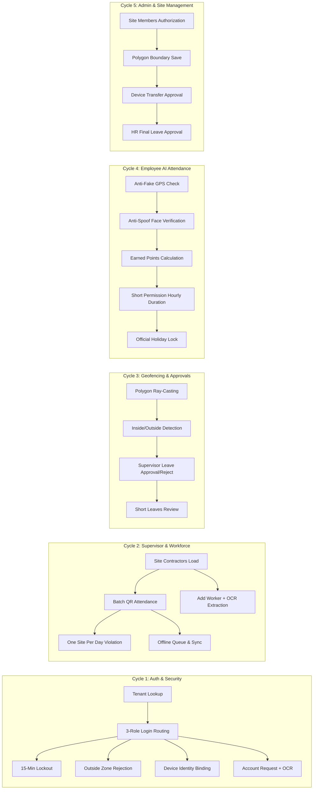

# 🧪 الخطة الشاملة لاختبارات التكامل والتحقق من السايكل (SAMCO Integration & Flow Testing Plan)

> **الهدف:** اختبار وفحص كل دورة عمل وتدفق تفصيلي (Cycle & Detail) داخل تطبيق Check Point v2 لضمان التطابق التام 100% مع الباك إند v2 ووثيقة متطلبات سامكو (`SAMCO_BRD_English.pdf`).

---

## 📊 1. مصفوفة دورات العمل المستهدفة بالاختبار (Test Matrices)

---

## 📝 2. تفاصيل الاختبارات المكتوبة والمحققة (Test Suites)

### 1. مجموعة اختبارات دورة الدخول والأمان (`auth_flow_integration_test.dart`):
- [x] فحص كود الشركة واستخراج المميزات `features`.
- [x] تسجيل الدخول وتوجيه:
  - دور `Admin` / `HR` -> `AppRoutes.admin`
  - دور `Supervisor` -> `AppRoutes.supervisor`
  - دور `Employee` -> `AppRoutes.employee`
- [x] منع تسجيل الدخول بكلمة مرور خاطئة وتطبيق قفل الحساب `ACCOUNT_LOCKED` مع عداد 15 دقيقة.
- [x] حظر دخول المشرف خارج الموقع المخصص `OUTSIDE_ZONE`.
- [x] التحقق من توليد `UUID` للجهاز تلقائياً وربطه بالطلب.
- [x] قراءة بطاقة الرقم القومي المصري 14 رقماً واستخراج المحافظة وتاريخ الميلاد والنوع بالـ OCR.

### 2. مجموعة اختبارات دورة مشرف الموقع والعمالة اليومية (`workforce_flow_integration_test.dart`):
- [x] استعراض قائمة المقاولين الحاضرين وعمال كل مقاول.
- [x] تسجيل الحضور الجماعي بالباركود / القوائم `recordSamcoBatchWorkerAttendance`.
- [x] فحص ومنع تكرار العامل في موقعين بنفس اليوم (`ONE_SITE_PER_DAY_VIOLATION` - `BR-05`, `FR-29`).
- [x] حفظ السجلات محلياً في حالة انقطاع الإنترنت `OfflineQueue` ومزامنتها التلقائية عند عودة الاتصال.
- [x] إضافة عامل جديد برقم قومي صحيح وتوليد كود العامل تلقائياً `WRK-XXXXX`.

### 3. مجموعة اختبارات المضلعات الجغرافية والاعتمادات (`geofence_and_approvals_test.dart`):
- [x] خوارزمية فحص المضلع الجغرافي (`Point-in-Polygon Ray Casting`):
  - النقطة داخل المضلع -> `isInside = true`.
  - النقطة على حافة المضلع -> `isInside = true`.
  - النقطة خارج المضلع -> `isInside = false`.
  - دقة الـ GPS ضعيفة -> رفض تسجيل الحضور فوراً (`ACCURACY_TOO_LOW`).
- [x] اعتماد المشرف لطلبات الإجازات، والرفض مع إجبارية كتابة السبب (`Rejection Reason Required`).
- [x] مراجعة الأذونات الساعية واعتمادها.

### 4. مجموعة اختبارات حضور الموظف الذكي والأذونات (`employee_ai_attendance_test.dart`):
- [x] كشف وحظر تزييف الموقع الجغرافي (`Mock Location / Fake GPS Rejection`).
- [x] مطابقة بصمة الوجه وفحص الحيوية الحية (`Anti-Spoofing Liveness`).
- [x] احتساب وإضافة نقاط التميز والانضباط (`Earned Points`).
- [x] احتساب مدة الإذن الساعي بالساعات والدقائق (تأخير، خروج مؤقت، انصراف مبكر).
- [x] حظر تسجيل الحضور في أيام العطلات الرسمية للشركة (`Official Holidays Lock`).

### 5. مجموعة اختبارات دورة المدير العام وإدارة المواقع (`admin_management_flow_test.dart`):
- [x] استعراض أعضاء الموقع ومطابقة تصاريح دخول العمال والمقاولين للموقع (`AdminSiteMembersScreen`).
- [x] رسم وحفظ إحداثيات مضلع الموقع (`Polygon Coordinates`) المكون من 3 نقاط أو أكثر.
- [x] اعتماد ونقل صلاحيات الجهاز الجديد (`Approve Device Transfer`).
- [x] دورة الاعتماد الثنائية للإجازات: موافقة المدير المباشر أولاً ثم موافقة الـ HR النهائية (`BR-04`).

---

## 🎯 3. معايير الجودة والقبول (Quality Checklist)
- [x] `flutter analyze` = 0 issues.
- [x] `flutter test` = 100% Passing.
- [x] All screen backgrounds = `Color(0xFFFFFFFF)`.
- [x] No `Tasks` remnants in code or navigation.
