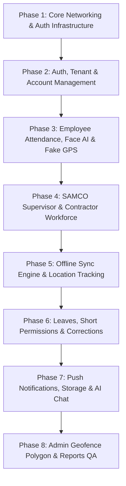

# 🚀 خطة تنفيذ وتكامل متطلبات سامكو وتحديثات الباك إند (SAMCO Mobile Integration Plan)
**الفرع المخصص للتطوير:** `samco-requirments`  
**تاريخ التوثيق:** أكتوبر 2026  
**الإصدار المستهدف للـ API:** `v2` (REST API v2)  
**معايير التصميم والتطوير:** الالتزام الصارم بـ `AGENTS.md` ونظام الثيم والـ Custom Widgets والـ Cubits و Freezed الحالي للتطبيق.

---

## 📌 1. المبادئ والقواعد الأساسية للتطوير
1. **الالتزام الكامل بالـ Design System الحالي:**
   - الألوان من [`AppColors`](file:///home/osama/Desktop/Systm-Gulf/check_point_v2/lib/core/styles/app_colors.dart).
   - النصوص من [`AppTextStyles`](file:///home/osama/Desktop/Systm-Gulf/check_point_v2/lib/core/styles/app_text_styles.dart).
   - المكونات الموحدة:
     - [`CustomButton`](file:///home/osama/Desktop/Systm-Gulf/check_point_v2/lib/core/widgets/custom_button.dart)
     - [`CustomTextFormField`](file:///home/osama/Desktop/Systm-Gulf/check_point_v2/lib/core/widgets/custom_text_form_field.dart)
     - [`CustomDialogWidget`](file:///home/osama/Desktop/Systm-Gulf/check_point_v2/lib/core/widgets/custom_dialog_widget.dart)
     - [`AppRejectReasonDialogWidget`](file:///home/osama/Desktop/Systm-Gulf/check_point_v2/lib/core/widgets/app_reject_reason_dialog_widget.dart)
     - [`AppDeleteConfirmationDialogWidget`](file:///home/osama/Desktop/Systm-Gulf/check_point_v2/lib/core/widgets/app_delete_confirmation_dialog_widget.dart)
     - [`CustomSnackBar`](file:///home/osama/Desktop/Systm-Gulf/check_point_v2/lib/core/widgets/custom_snack_bar.dart)
     - [`AppCardContainerWidget`](file:///home/osama/Desktop/Systm-Gulf/check_point_v2/lib/core/widgets/app_card_container_widget.dart)
     - [`AppMultiSelectDropdownWidget`](file:///home/osama/Desktop/Systm-Gulf/check_point_v2/lib/core/widgets/app_multi_select_dropdown_widget.dart)
2. **الترجمة الكاملة (Localization):**
   - منع استخدام أي نصوص ثابتة (Hardcoded Strings).
   - إضافة كافة النصوص في `assets/translations/ar.json` و `assets/translations/en.json` بنمط `feature.section.key` واستخدام `.tr()`.
3. **المعمارية وإدارة الحالة (Clean Architecture & BLoC):**
   - `UI → Cubit → Repository` أو `UI → Cubit → UseCase → Repository` فقط عند وجود منطق معقد.
   - لا يتم إنشاء Domain Entities؛ استخدام DTOs/Models (`*_model.dart`) مباشرة مع `freezed` و `json_serializable`.
   - استخدام Dart 3 Switch Expressions و Pattern Matching مع Object Destructuring.
   - حقن التبعيات (DI) عبر `GetIt` في `lib/core/di/service_locator.dart`.
   - المسارات مركزية في `lib/core/routes/app_router.dart` و `routes.dart`.
   - تشغيل `dart run build_runner build --delete-conflicting-outputs` بعد أي تعديل في الـ Freezed / Retrofit.

---

## 🗂️ 2. تقسيم المراحل التنفيذية (Phases Breakdown)

---

### 🔹 Phase 1: Core Networking, Multi-Tenant & Token Refresh Interceptor
*تسكات الربط:* `MOB-006`, `MOB-007`, `API-014`, `API-007`

#### الأهداف والمهام:
1. **تحديث `AuthTokenInterceptor` & `DioFactory`:**
   - حقن الـ Headers الإلزامية: `x-tenant-slug`, `x-device-uuid`, `Authorization: Bearer <token>`.
   - تطبيق آلية التجديد التلقائي للـ Token (`POST /api/v2/auth/refresh`) عند استقبال `401 Unauthorized`.
   - حفظ واسترجاع الـ `refreshToken` بشكل آمن عبر `FlutterSecureStorage`.
   - في حال فشل التجديد: توجيه المستخدم لشاشة تسجيل الدخول وتنظيف الجلسة.
2. **تحديث `ApiConstants`:**
   - نقل وتوحيد الـ Endpoints للـ `v2` (مثل `/api/v2/auth/login`, `/api/v2/attendance/clock-in`, `/api/v2/workforce/samco/...`).
3. **تحديث `ApiFailureMapper` و `ApiFailure`:**
   - دعم القاموس القياسي للأخطاء: `OUTSIDE_ZONE`, `ACCOUNT_LOCKED`, `ONE_SITE_PER_DAY_VIOLATION`, `UNAUTHORIZED`, `OFFICIAL_HOLIDAY`, `DEVICE_NOT_APPROVED`, `GPS_ACCURACY_TOO_LOW`.

---

### 🔹 Phase 2: Tenant Verification, Self-Registration & Enhanced Login
*تسكات الربط:* `MOB-014`, `MOB-015`, `MOB-016`, `MOB-017`, `MOB-018`, `MOB-019`, `MOB-020`, `MOB-021`, `API-021`, `API-022`, `API-027`

#### الأهداف والمهام:
1. **شاشة البداية والتحقق من كود الشركة (Tenant Verification):**
   - مطابقة `GET /api/v1/tenant/verify?tenantSlug=...` وتخزين صلاحيات وميزات المستأجر (`features`).
2. **شاشة تسجيل الدخول وقفل الحسابات (Login & Account Lockout):**
   - إرسال `mobileId`, `deviceModel`, `osVersion`, `latitude`, `longitude` مع الـ Login.
   - معالجة `ACCOUNT_LOCKED` (403): إظهار عداد تنازلي للـ 15 دقيقة وتعطيل زر الدخول مؤقتاً عبر نفس تصميم الـ Widgets الحالي.
   - معالجة `OUTSIDE_ZONE` (403) لمشرفي الموقع: إظهار `CustomDialogWidget` بالتحذير من ضرورة التواجد بالموقع.
3. **طلب إنشاء حساب جديد وربط الجهاز (Self-Registration & Binding):**
   - `POST /api/v2/employees/account-requests` مع إرسال الـ UUID التلقائي والتفاصيل المطلوبة.
   - شاشة متابعة حالة الطلب (معلقة / مقبولة / مرفوضة بالسبب).

---

### 🔹 Phase 3: Employee Attendance, Face AI & Fake GPS Protection
*تسكات الربط:* `MOB-041`, `MOB-042`, `MOB-043`, `MOB-044`, `MOB-045`, `MOB-046`, `MOB-047`, `MOB-050`, `API-040`, `API-041`, `API-091`, `API-092`, `API-093`

#### الأهداف والمهام:
1. **تسجيل الحضور والانصراف (Clock In / Clock Out v2):**
   - `POST /api/v2/attendance/clock-in` مع مصفوفة الإحداثيات `coordinates` (`latitude`, `longitude`, `accuracyM`) ورابط صورة الوجه `employeeImage`.
   - `POST /api/v2/attendance/clock-out` مع الإحداثيات والدقة.
2. **التحقق من الوجه وكشف التزييف (AI Gateway & Fake GPS):**
   - تكامل `POST /api/v2/ai/face/verify` مع استرجاع القرار (`ACCEPT`, `REVIEW`, `REJECT`) ونسب التطابق وحيوية الوجه `antiSpoofScore`.
   - تكامل `POST /api/v2/ai/gps/risk` وفحص الـ Mock Location والدقة.
3. **استعراض نتائج الحضور ونقاط التميز (Earned Points):**
   - إظهار حالة الحضور، النقاط المكتسبة (`earnedPoints`, `pointType`), وتأكيد التواجد داخل الـ Geofence.

---

### 🔹 Phase 4: SAMCO Supervisor & Contractor Workforce Management
*تسكات الربط:* `MOB-052`, `MOB-053`, `MOB-054`, `MOB-055`, `MOB-056`, `MOB-057`, `MOB-058`, `MOB-059`, `API-049`, `API-050`, `API-051`, `API-052`, `API-053`, `API-054`

#### الأهداف والمهام:
1. **جلب حدود الموقع وخريطة الـ Polygon:**
   - `GET /api/v2/workforce/samco/sites/{siteId}/boundary` وعرض المضلع المظلل على Google Maps.
2. **حضور المقاولين اليومي بالموقع:**
   - `POST /api/v2/workforce/samco/attendance/contractors` لتسجيل حضور المقاول والملاحظات.
3. **تسجيل الحضور الجماعي لعمال المقاول بالباركود / QR (Batch Worker Presence):**
   - `POST /api/v2/workforce/samco/attendance/workers/batch`
   - معالجة قاعدة الموقع الواحد يومياً (`ONE_SITE_PER_DAY_VIOLATION`): إظهار نتائج العمال المقبولين والمرفوضين واسم الموقع المتعارض بالتفصيل.
4. **قائمة العمال والتحقق من الرقم القومي المصري (14-digit National ID):**
   - `GET /api/v2/workforce/samco/workers?contractor_id=...` واستعراض تفاصيل الرقم القومي المستخرجة (تاريخ الميلاد، المحافظة، النوع).

---

### 🔹 Phase 5: Offline Sync Engine & Live Background Tracking
*تسكات الربط:* `MOB-008`, `MOB-028`, `MOB-029`, `MOB-030`, `MOB-063`, `API-042`, `API-059`, `API-061`, `API-062`

#### الأهداف والمهام:
1. **محرك المزامنة بدون إنترنت (Offline Sync Engine):**
   - تخزين سجلات حضور العمال محلياً عند انقطاع الاتصال.
   - `POST /api/v2/workforce/samco/attendance/sync` لإرسال السجلات دفعة واحدة ومزامنتها عند عودة الشبكة.
2. **خدمة التتبع الحي في الخلفية أثناء وقت الشفت:**
   - جمع الإحداثيات كل دقيقة وحفظها مؤقتاً.
   - `POST /api/v2/attendance/tracking/batch` لإرسال حزم الإحداثيات (`latitude`, `longitude`, `accuracyM`, `batteryPct`, `recordedAt`).

---

### 🔹 Phase 6: Leaves, Short Permissions & Attendance Corrections
*تسكات الربط:* `MOB-064`, `MOB-065`, `MOB-066`, `MOB-067`, `MOB-068`, `API-046`, `API-067`, `API-069`, `API-071`, `API-072`

#### الأهداف والمهام:
1. **طلب الإجازات والأذونات الساعية:**
   - `POST /api/v2/leaves` للإجازات الاعتيادية والمرضية مع المرفقات.
   - `POST /api/v2/leaves/short-leaves` للأذونات الساعية (تأخير صباحي، انصراف مبكر، خروج مؤقت).
2. **اعتماد ورفض الإجازات من المشرف والـ HR:**
   - `POST /api/v2/leaves/{leaveId}/approve`
   - `POST /api/v2/leaves/{leaveId}/reject` باستخدام `AppRejectReasonDialogWidget`.
3. **تصحيح وتظلمات الحضور:**
   - `POST /api/v2/attendance/corrections` لتقديم طلبات التعديل والتظلمات.

---

### 🔹 Phase 7: Push Notifications, Secure File Storage & AI Chat
*تسكات الربط:* `MOB-010`, `MOB-075`, `MOB-077`, `MOB-078`, `MOB-093`, `MOB-094`, `MOB-095`, `API-083`, `API-084`, `API-085`, `API-088`, `API-095`

#### الأهداف والمهام:
1. **مركز الإشعارات والـ FCM Token:**
   - `POST /api/v2/notifications/register-token` لتسجيل وتحديث التوكن.
   - `GET /api/v2/notifications` و `POST /api/v2/notifications/read-all`.
2. **تنبيهات الخروج من الموقع للمشرف والـ HR (Out of Zone Alerts):**
   - عرض تنبيه الخروج من الموقع مع خريطة جوجل بنقطة الخروج ومضلع الموقع.
3. **خدمة رفع الملفات الآمنة (HMAC Signed URLs):**
   - `POST /api/v2/storage/signed-upload-url` والرفع المباشر عبر الرابط الموقع.
4. **المساعد الذكي AI Chat Assistant:**
   - واجهة المحادثة الذكية مع معالجة الردود والاستجابات السريعة.

---

### 🔹 Phase 8: Admin Geofence Polygon Editor, Reports & QA Verification
*تسكات الربط:* `MOB-081`, `MOB-082`, `MOB-083`, `MOB-088`, `MOB-102`, `MOB-103`, `API-029`, `API-030`, `API-077`, `API-081`

#### الأهداف والمهام:
1. **أداة رسم وتعديل مضلع الموقع على Google Maps:**
   - رسم مضلع الـ Geofence بنقاط متعددة مع أزرار (Undo, Clear, Count).
   - التحقق من إغلاق المضلع (3 نقاط على الأقل) وحفظه في السيرفر.
2. **تقارير الحضور والمقاولين وتصدير الـ PDF/Excel:**
   - تقرير الحضور اليومي للموقع، وقائمة عمال المقاولين.
3. **الفحص والتحقق من الجودة (QA):**
   - التأكد من عدم وجود أي خطأ في التحليل (`flutter analyze`).
   - تشغيل `dart run build_runner build --delete-conflicting-outputs`.
   - اختبار تدفق كافة الشاشات على الفرع `samco-requirments`.

---

## 📋 حالة البداية والخطوة القادمة
- [x] تم إنشاء البرانش `samco-requirments` بنجاح.
- [x] تم قراءة وتحليل كافة المتطلبات وملفات ClickUp ودليل التكامل.
- [x] تم إعداد هذا الملف كخارطة طريق كاملة ومطابقة للقواعد.
- [ ] انتظار موافقة المستخدم للانطلاق في تنفيذ **Phase 1** فوراً.
