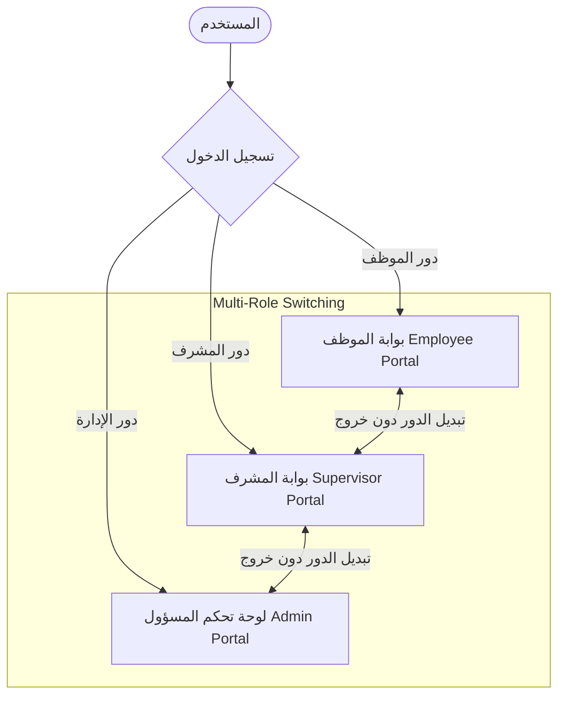
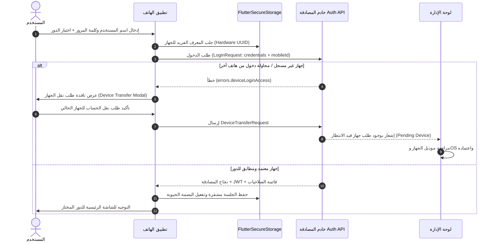
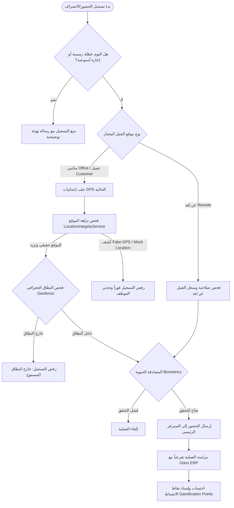
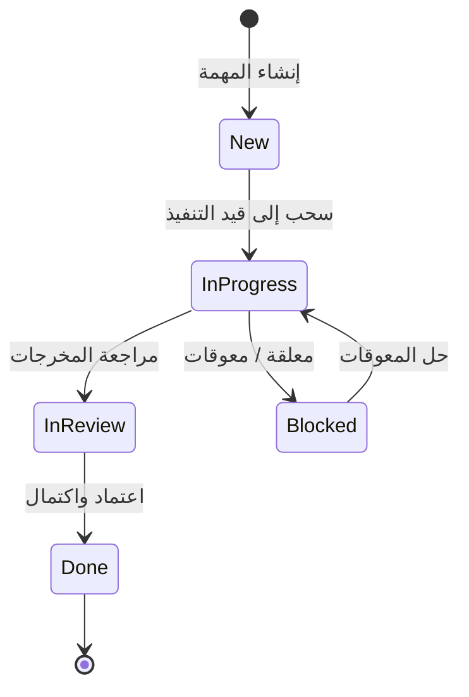
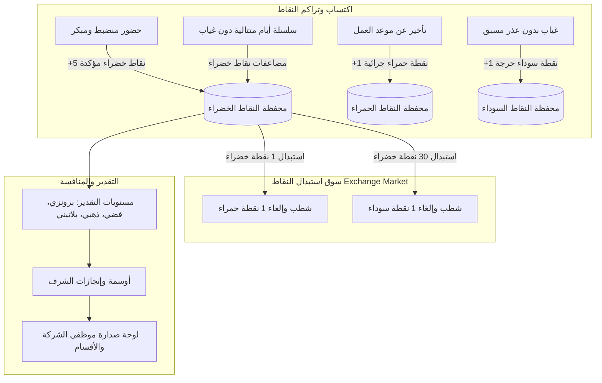
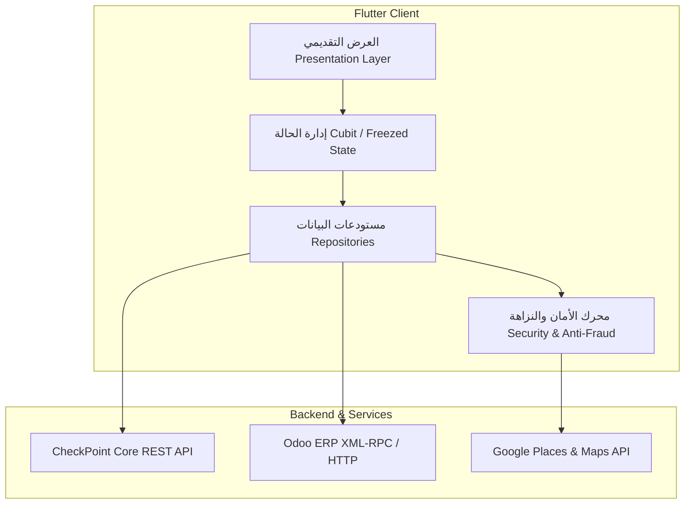

# وثيقة متطلبات ووظائف الأعمال الشاملة (Business Document)
## نظام CheckPoint HRM — إدارة الموارد البشرية والميدانية الذكية
**إصدار التطبيق:** 1.0.0+4 | **الفرع الحالي:** `main` | **تاريخ التوثيق:** أكتوبر 2026

---

## 1. الملخص التنفيذي ورؤية النظام (Executive Summary & Vision)

**نظام CheckPoint HRM** هو منصة متقدمة لإدارة الموارد البشرية والعمليات الميدانية، صُممت خصيصاً للشركات والمؤسسات التي تدير مزيجاً من الموظفين المكتبيين، الفرق الميدانية، وفرق العمل عن بُعد / الهجين.

### الرؤية والهدف الاستراتيجي:
1. **القضاء التام على التحايل (Zero-Fraud Attendance):** الاعتماد على التحقق الثلاثي (الموقع الجغرافي الدقيق + كشف تزييف المواقع Mock GPS + المصادقة الحيوية Biometrics) وربط كل حساب بجهاز مادي وحيد (Hardware UUID Binding).
2. **إدارة العمليات الميدانية والعملاء (Field Operations & Client Visits):** تحويل تطبيق الحضور إلى أداة إنتاجية تمكّن الموظف من تسجيل زيارات العملاء الميدانية وإرفاق المستندات ونتائج الاجتماعات مع التحقق المكاني.
3. **أتمتة دورات الاعتماد المتقدمة (Multi-Stage Approval Workflows):** مسارات موافقات مرنة ثنائية المرحلة (المدير المباشر &larr; الموارد البشرية/الإدارة) للإجازات والمغادرات والعمل الإضافي والعمل عن بُعد.
4. **التحفيز بالألعاب (Gamification & Points Engine):** نظام متكامل للنقاط الإيجابية والجزائية وسوق استبدال النقاط وسجل المتصدرين لتحفيز الانضباط والالتزام بمواعيد العمل.
5. **التكامل المؤسسي (ERP Synchronization):** مزامنة لحظية مع نظام **Odoo ERP** لسجلات الحضور والانصراف والإجازات والعطلات الرسمية.

---

## 2. مصفوفة الأدوار ونموذج الصلاحيات (User Personas & RBAC)

يدعم النظام نموذج صلاحيات هجين يجمع بين الأدوار الأساسية (Base Roles) والصلاحيات الدقيقة القابلة للتخصيص (Fine-Grained Permissions):



### 2.1 تصنيف الأدوار الأساسية:

| الدور (Persona) | الجمهور المستهدف | نطاق المسؤولية والوظائف الرئيسية |
|---|---|---|
| **الموظف (Employee)** | كافة موظفي الشركة (مكتبي، ميداني، عن بُعد) | تسجيل الحضور والانصراف الذاتي، متابعة المهام وساعات العمل، تقديم طلبات الإجازات والمغادرات، مراجعة رصيد النقاط والأوسمة واستبدالها، تسجيل زيارات وخطط العملاء. |
| **المشرف (Supervisor)** | رؤساء الأقسام، قادة الفرق الميدانية | متابعة حضور الفريق لحظياً، تسجيل الحضور نيابة عن أعضاء الفريق، اعتماد المرحلة الأولى للإجازات والمغادرات والعمل الإضافي، إسناد المهام وخطط العمل، استعراض دليل الفريق. |
| **المسؤول (Admin / HR)** | مدراء الموارد البشرية، الإدارة التنفيذية، مسؤولو النظام | الإشراف الكامل على المنظمة، إدارة الموظفين ودورة حياتهم، إعداد الفروع والمضلعات الجغرافية (Geofences)، تعريف المناوبات وسياسات العمل، اعتماد الأجهزة وطلبات الحسابات، إدارة الكتالوج الكامل للصلاحيات. |

### 2.2 ميزة تعدد الأدوار والتبديل الحي (Multi-Role Switching):
- يدعم النظام امتلاك المستخدم لأكثر من دور (مثال: موظف يحمل صلاحية إشرافية `Employee + Supervisor`).
- تتيح شاشة الملف الشخصي للمستخدم التبديل الفوري بين واجهات الأدوار (`RoleSwitchDialogWidget`) دون الحاجة لتسجيل الخروج، حيث يتم تحديث الجلسة المشفرة وتفعيل الصلاحيات المناسبة لحظياً.

---

## 3. الوحدات الوظيفية التفصيلية للنظام (Core Functional Modules)

---

### الوحدة الأولى: الأمان، إدارة الهوية، وربط الأجهزة (Hardware Binding & Security)



#### الوظائف الرئيسية:
1. **المعرف الفريد للجهاز (Device Identity Binding):**
   - يُنشئ التطبيق معرّف أجهزة عشوائي مشفر (UUID v4) ويخزنه في `FlutterSecureStorage`.
   - لا يُسمح بتسجيل الدخول إلا من الجهاز المعتمد والمربوط بحساب الموظف في قاعدة البيانات لمنع تسجيل الحضور بالنيابة (Buddy Punching).
2. **بروتوكول نقل وترقية الأجهزة (Device Transfer Protocol):**
   - عند محاولة الدخول من هاتف جديد، يُطلب من الموظف إرسال طلب نقل جهاز، ويظهر الطلب للمسؤول في شاشة `AdminDevicesScreen` متضمناً موديل الهاتف وإصدار نظام التشغيل وتاريخ الطلب.
3. **طلبات الحسابات الذاتية (Self-Registration Account Requests):**
   - إمكانية قيام الموظفين الجدد بتقديم طلب فتح حساب من شاشة `RequestAccessScreen`.
   - يجمع الطلب: الاسم الكامل، الرقم القومي (14 رقماً مصرياً مدققاً)، رقم الهاتف، صورة شخصية (مضغوطة تلقائياً بتقنية Canvas)، معرّف الجهاز `mobileId`.
   - متابعة لحظية لحالة الطلب عبر شريط ملون في شاشة الدخول (أصفر: قيد المراجعة، أحمر: مرفوض مع سبب الرفض، أخضر: معتمد).
4. **المصادقة البيومترية المتقدمة (Biometrics):**
   - دعم بصمة الإصبع والتعرف على الوجه لتسجيل الدخول السريع وتأكيد عمليات تسجيل الحضور الحساسة.
5. **الحماية من هجمات التخمين (Rate Limiting Protection):**
   - اعتراض رسائل الخادم الخاصة بتجاوز محاولات الدخول، وقراءة وقت الانتظار ديناميكياً وتشغيل مؤقت عد تنازلي يعطل زر الإرسال.

---

### الوحدة الثانية: محرك الحضور والانصراف ومكافحة التلاعب (Time & Attendance Engine)



#### القدرات الجوهرية:
1. **التحقق الجغرافي المزدوج (Circular Radius & Polygonal Boundaries):**
   - يدعم النظام نطاقات الحضور الدائرية البسيطة (مسافة نصف القطر بالمتر، افتراضياً 150م بمعادلة Haversine).
   - يدعم النطاقات المضلعة المتقدمة (Multi-Point Polygons) للمنشآت والمصانع والمواقع الكبيرة باستخدام خوارزمية الشعاع القاطع (Ray-Casting Algorithm).
2. **منظومة كشف تزييف المواقع (Anti-Spoofing & Location Integrity Engine):**
   - فحص علامة الـ Mock Location على مستوى نظام التشغيل عبر `MethodChannel`.
   - رفض قراءات GPS ذات الدقة المنخفضة (> 50 متراً).
   - رفض القراءات القديمة (Stale Samples) التي يتجاوز عمرها 30 ثانية.
   - كشف القفزات المكانية المستحيلة فيزيائياً (> 140 كم/ساعة أو قفز أكثر من 500م خلال 3 ثوانٍ).
3. **تعدد مواقع الحضور في اليوم الواحد:**
   - حضور في المقر الرئيسي (Branch).
   - حضور وانصراف في مواقع ومقرات العملاء (Customer Sites & Field Visits) مع إمكانية تسجيل أكثر من زيارة في نفس يوم العمل بعد الانصراف من المقر.
4. **المزامنة المتزامنة مع Odoo ERP:**
   - يتم إرسال طلب تسجيل الحضور أو الانصراف إلى الخادم المركزي، وبالتوازي تقوم خدمة `OdooAttendanceService` بتسجيل الحركة في موديول الحضور في Odoo مع تحديد وسام الموقع (`office`, `customer`, `site`).
5. **سجل الحضور والاحتساب التلقائي:**
   - احتساب دقيق لساعات العمل الفعلية (`Xh Ym`)، التأخير بالدقائق، والانصراف المبكر بالدقائق بناءً على السياسة المحددة للموظف.

---

### الوحدة الثالثة: إدارة الإجازات والمغادرات (Leaves & Short Permissions)

يدير النظام نوعين رئيسيين من الغيابات المصرح بها وفق دورة اعتماد متقدمة:

#### 3.1 دورة الاعتماد ثنائية المراحل (Two-Stage Workflow):
```text
تقديم الطلب (موظف) ──> [المرحلة 1: مراجعة المدير المباشر] ──> [المرحلة 2: اعتماد الموارد البشرية HR] ──> موافقة نهائية
                                │                                           │
                                └──> رفض مع ذكر السبب                       └──> رفض مع ذكر السبب
```
- **حالات الطلب في النظام:**
  - `Pending` / `PendingManager`: في انتظار قرار المدير المباشر.
  - `PendingHR` / `PendingAdmin`: وافق المدير وبانتظار اعتماد الـ HR.
  - `Approved`: معتمد نهائياً ومخصوم من الرصيد.
  - `RejectedByManager` / `RejectedByHR`: مرفوض مع توثيق سبب الرفض واسم متخذ القرار وتاريخه.

#### 3.2 أنواع الإجازات وقواعد السياسات (Policy Engine):
- **الإجازات الاعتيادية والسنوية:** تتطلب التقديم المسبق (بحد أدنى 48 ساعة قبل الموعد).
- **الإجازات العارضة (Casual Leaves):** يكتشف التطبيق تلقائياً إذا كان تاريخ البداية هو اليوم نفسه ليحددها كإجازة عارضة، مع فرض قيود السياسة (عدم جواز طلب يومين عارضة متتاليين، ومراعاة الحد الأقصى السنوي).
- **المرفقات الإلزامية والتقارير الطبية:** إذا كان نوع الإجازة يتطلب مستنداً إثباتياً (مثل الإجازة المرضية)، يفرض النظام إرفاق ملف (PDF أو صور)، مع ضغط تلقائي وتشفير Base64.
- **أرصدة الإجازات الديناميكية (Leave Balances):** بطاقات ملونة توضح: الإجمالي السنوي المخصص، المستهلك، المتبقي، والرصيد المرحّل من السنوات السابقة.

#### 3.3 تصاريح المغادرة القصيرة (Short-Leave Permits):
يدعم النظام ثلاثة أصناف للتصاريح اليومية:
1. **تأخير صباحي (Late Arrival):** احتساب الفترة من بداية المناوبة المعتمدة حتى وقت الحضور المطلوب.
2. **انصراف مبكر (Early Departure):** احتساب الفترة من وقت الانصراف حتى نهاية المناوبة.
3. **خروج مؤقت (Temporary Exit):** فترة مغادرة محددة بالساعة والدقيقة والعودة خلال يوم العمل.
- **التحقق من نافذة المناوبة:** التحقق الصارم من عدم تعارض وقت المغادرة مع العطلات الأسبوعية ووقوعه داخل ساعات المناوبة الرسمية وعدم تجاوزه للحد الأقصى المسموح شهرياً.

#### 3.4 العطلات الرسمية للشركة والدولة (Official Holidays):
- استعراض الأعياد والمناسبات الرسمية عبر بطاقة تفاعلية توضح العطلة القادمة وعدد الأيام المتبقية لها.
- قدرة الإدارة على جدولة العطلات أو ترحيلها (Reschedule) مع توثيق السبب واستثناء أقسام معينة إذا تطلبت طبيعة عملها التواجد.

---

### الوحدة الرابعة: خطط العملاء والزيارات الميدانية (Field Plans & Customer Visits)

صُممت هذه الوحدة لموظفي المبيعات، الصيانة، والدعم الميداني:


#### الوظائف الرئيسية:
1. **جدولة خطط العملاء:**
   - تحديد العميل المستهدف، تاريخ ووقت الزيارة، الموظف المسؤول والمرافقين.
   - إرفاق وثيقة جدول الأعمال أو خطة ما قبل الاجتماع.
2. **التحقق المكاني عند العميل:**
   - الربط بقاعدة بيانات العملاء ومواقعهم الجغرافية.
   - التحقق من تواجد الموظف في مقر العميل عبر الخريطة التفاعلية قبل السماح بتسجيل الحضور.
3. **تسجيل نتائج ومخرجات الزيارة (Visit Outcomes):**
   - نموذج تفصيلي لإدخال تقرير ما بعد الزيارة، القرارات المتخذة، والخطوات التالية.
   - إرفاق صور العقود، إيصالات التسليم، أو التقارير الفنية الموقعة مع دعم عارض المستندات الشامل (`AppDocumentViewerDialogWidget`).
4. **إعادة الجدولة والإلغاء مع سجل تدقيق كامل:**
   - لا يمكن إلغاء أو تأجيل زيارة دون إدخال سبب رسمي مبرر، وتُسجل كل حركة في `VisitChangeLogModel` مع هوية الموظف وتاريخ التعديل.

---

### الوحدة الخامسة: إدارة المشاريع والمهام (Projects & Kanban Board)

نظام إدارة مشاريع ومهام متكامل مدمج داخل تطبيق الموارد البشرية لتوحيد بيئة العمل:



#### الوظائف الرئيسية:
1. **لوحة كانبان التفاعلية (Interactive Kanban Board):**
   - تقسيم المشروع إلى أعمدة حالات مخصصة (Custom Status Columns) بألوان مميزة.
   - إمكانية نقل المهام بين الأعمدة بالسحب والإفلات التفاعلي (`LongPressDraggable` و `DragTarget`).
   - عرض بديل بنظام القائمة المجدولة (Tabbed List View).
2. **بطاقة المهمة وتفاصيلها:**
   - عنوان ووصف المهمة، تاريخ البداية وتاريخ الاستحقاق.
   - مستوى الأولوية بالألوان: منخفض (Low)، متوسط (Medium)، مرتفع (High)، حرج (Critical)، عاجل (Urgent).
   - فريق العمل المكلف (Multi-Assignees) مع صورهم الرمزية.
   - وسوم التصنيف (Tags) والملفات المرفقة.
3. **تسجيل ساعات العمل وسجلات الإنتاجية (Task Time Logs):**
   - تسجيل فترات العمل الفعلية على المهام (`durationMinutes` والملاحظات).
   - شاشات تقارير لحساب الساعات الإنتاجية الكلية للموظف ومقارنتها بالساعات المخططة.
4. **سجل تدقيق المهام (Task Audit Trail):**
   - متابعة تاريخ المهمة: من أنشأها، من غيّر حالتها، وتاريخ كل تعديل.

---

### الوحدة السادسة: نظام العمل عن بُعد والسياسات المرنة (Remote Work Engine)

تنظيم بيئات العمل غير المكتبية وفق أطر امتثال واضحة:

#### الوظائف الرئيسية:
1. **أنواع سياسات العمل (Policy Types):**
   - **عمل مكتبي (On-site):** حضور إلزامي في مقرات وفروع الشركة.
   - **عمل عن بُعد كامل (Remote):** السماح بتسجيل الحضور دون قيود الجيوفينس للمقر، مع تسجيل الإحداثيات للمتابعة.
   - **عمل هجين (Hybrid):** تحديد أيام محددة للحضور المكتبي (مثال: الأحد، الثلاثاء) وأيام مسموح بها عن بُعد، مع تحديد سقف أقصى لأيام العمل عن بُعد أسبوعياً.
2. **بوابة فحص الأهلية (Work Access Gate):**
   - يتحقق التطبيق تلقائياً عبر `EmployeeWorkAccessCubit` من نظام العمل المعتمد للموظف في عقده قبل تمكينه من اختيار "حضور عن بُعد".
3. **طلبات العمل عن بُعد الاستثنائية:**
   - إمكانية تقديم الموظف المكتبي لطلب يوم عمل عن بُعد مبرر يمر بدورة اعتماد المشرف مع إمكانية الرد بملاحظات.

---

### الوحدة السابعة: إدارة العمل الإضافي (Overtime Management)

#### الوظائف الرئيسية:
1. **تقديم طلبات العمل الإضافي:**
   - تحديد تاريخ اليوم، وقت البدء، وقت الانتهاء، ومبرر العمل الإضافي.
   - الاحتساب التلقائي لعدد الدقائق والساعات بدقة.
   - تطبيق قيود التحقق (حد أدنى 30 دقيقة، عدم تداخل الأوقات، وصحة النطاق الزمني).
2. **مراجعة واعتماد المشرفين:**
   - يظهر للمشرف قائمة طلبات إضافي الفريق مع تفاصيل الموظف ومعدل الدقائق.
   - خيارات القبول أو الرفض مع حقل إلزامي لكتابة مبرر القرار (`reviewNote`).

---

### الوحدة الثامنة: نظام التحفيز والنقاط وسوق الاستبدال (Gamification & Points Engine)

نظام مكافآت وجزاءات رقمي متقدم يهدف إلى غرس ثقافة الانضباط الذاتي:



#### هيكل النقاط:
- **النقاط الخضراء (Green Points):** تمنح للموظف المنضبط (حضور في الموعد أو مبكراً، الحفاظ على سجل الحضور). تنقسم إلى نقاط مؤكدة (Confirmed) ونقاط قيد التأكيد (Pending) لحين انتهاء يوم العمل.
- **النقاط الحمراء (Red Points):** نقاط جزائية تترتب على التأخيرات الصباحية أو الانصراف المبكر البسيط.
- **النقاط السوداء (Black Points):** نقاط جزائية مشددة تترتب على الغياب غير المبرر أو الانتهاكات الصريحة للسياسات.

#### سوق الاستبدال (Point Exchange Market):
- يحق للموظف استخدام رصيده من النقاط الخضراء لمسح وشطب النقاط الجزائية:
  - **1 نقطة خضراء** &larr; تشطب **1 نقطة حمراء**.
  - **30 نقطة خضراء** &larr; تشطب **1 نقطة سوداء**.
- عمليات الاستبدال محمية بمفتاح منع التكرار (`idempotencyKey`) لضمان عدم ازدواجية الخصم.

#### التقدير والترقي (Progression & Tiers):
- سلم الترقية: **برونزي (Bronze) &larr; فضي (Silver) &larr; ذهبي (Gold) &larr; بلاتيني (Platinum)** بناءً على رصيد النقاط الصافي.
- متابعة سلاسل الانضباط (Current Streak & Highest Streak).
- أوسمة الإنجازات (Badges) باللغتين العربية والإنجليزية مع شريط نسبة تقدم فتح الوسام.
- لوحة المتصدرين (Leaderboard) وتتويج أصحاب المراكز الثلاثة الأولى (منصة التتويج الذهبية والفضية والبرونزية).
- شاشة خاصة للمسؤولين لمراقبة أرصدة نقاط جميع الموظفين وسجل العمليات.

---

### الوحدة التاسعة: الهيكل التنظيمي والحوكمة المؤسسية (Organizational Topology)

تخضع كافة عمليات النظام لهيكل إداري متين تديره لوحة تحكم المسؤول:

1. **إدارة الفروع والمواقع الجغرافية (Branches & Geofences):**
   - تسجيل الفروع مع إحداثيات خطوط الطول والعرض ونطاقات الأمان.
   - دعم رسم حدود الفروع كمضلعات جغرافية متصلة على الخريطة.
2. **إدارة الأقسام (Departments):**
   - هيكلة الأقسام، تعيين المشرفين عليها، استعراض قائمة موظفي كل قسم وإحصائياتهم.
3. **دليل العملاء ومواقع العمل (Customers & Work Sites):**
   - تسجيل مواقع العملاء وربطها بالخرائط مع دعم ميزة البحث والتكملة التلقائية عبر Google Places API.
4. **سياسات ومناوبات العمل (Shifts & Working Policies):**
   - إنشاء المناوبات (صباحية، مسائية، مرنة).
   - إعداد سياسات الدوام: أيام العمل الأسبوعية، مواعيد الحضور والانصراف، فترات السماح للتأخير (Grace Period بالدقائق)، وفترات السماح للانصراف المبكر.
   - إسناد السياسات للموظفين وإمكانية نقل الموظف بين المناوبات بأمان وتلقائية.

---

### الوحدة العاشرة: دورة حياة الموظف وسجلات التدقيق (Employee Lifecycle & Audit)

1. **معالج إضافة موظف جديد بـ 4 خطوات (4-Step Onboarding Wizard):**
   - **الخطوة 1: البيانات الشخصية:** الاسم، اسم المستخدم، كلمة المرور، الهاتف، الرقم القومي، والصورة الشخصية (يدعم الملء التلقائي في حال تحويل طلب حساب معتمد).
   - **الخطوة 2: الوظيفة والدور:** كود الموظف التلقائي (`EMP-XXXX`)، المسمى الوظيفي، الأدوار الممنوحة، المدير المباشر، والصلاحيات التفصيلية.
   - **الخطوة 3: التسكين التنظيمي:** الفرع، القسم، ونظام العمل (مكتبي أو سياسة عمل عن بُعد).
   - **الخطوة 4: المراجعة والاعتماد:** ملخص شامل لكافة البيانات قبل الإنشاء النهائي.
2. **الملف الشامل للموظف (Employee 360° Profile):**
   - مقسم إلى 3 تبويبات رئيسية: (بيانات الوظيفة والتعاقد والراتب - سجل الحضور وساعات العمل الشهرية وأرصدة الإجازات - الأجهزة المسجلة وتاريخ الأمان).
3. **سلة المحذوفات والمحو الآمن (Soft Delete & Recycle Bin):**
   - حذف الموظف لا يمسح بياناته المالية والرقابية فوراً؛ بل ينقله إلى سلة المحذوفات.
   - إمكانية استعادة الموظف بالكامل (`Restore`) أو حذفه نهائياً وبشكل لا رجعة فيه (`Permanent Purge`).
4. **سجل التدقيق الشامل (System Audit Logs):**
   - تسجيل كل عملية تعديل في النظام مع توثيق: من الفاعل (`actorId` / `actorName`)، نوع الإجراء، التاريخ والوقت، وتفاصيل الحقول قبل التعديل (`before`) وبعد التعديل (`after`).

---

## 4. البنية التقنية ومواصفات التكامل (Technical Architecture & Integrations)



### 4.1 حزمة التقنيات الرئيسية (Technology Stack):
- **إطار العمل ولغة البرمجة:** Flutter 3.x / Dart 3.10+
- **إدارة الحالة:** `flutter_bloc` (Cubits) مع حالات `freezed` غير قابلة للتغيير.
- **التصميم وتجاوب الشاشات:** `flutter_screenutil_plus` و `Material 3` بالخط الرسمي المعتمد `IBMPlexSansArabic`.
- **الشبكات ومكالمات الـ API:** `dio` + `retrofit` مع نمط النتيجة الوظيفية `ApiResult<T>` و `ApiFailureMapper`.
- **حقن التبعيات (DI):** `get_it` عبر `lib/core/di/service_locator.dart`.
- **التخزين الآمن:** `flutter_secure_storage` للمفاتيح ورموز JWT ومعرفات الأجهزة، و `shared_preferences` للإعدادات العامة.
- **التدويل واللغات (Localization):** دعم كامل للغتين العربية (الفصحى واللهجة المصرية) والإنجليزية مع مراعاة كاملة لاتجاه النصوص (RTL/LTR) والتقويم والأرقام.

### 4.2 الأنظمة المترابطة (Third-Party Integrations):
1. **نظام Odoo ERP:** مزامنة حضور الموظفين والإجازات الرسمية والعطلات والتحقق من حالة الحضور.
2. **Google Maps & Places Services:** عرض خرائط التحقق من الموقع، البحث عن عناوين العملاء والمقرات بدقة عبر عميل Dio خارجي معزول أمنياً لحماية مفاتيح التوكن الخاصة بالمؤسسة.
3. **Local Authentication:** ربط الحماية بالعتاد الحيوي (بصمة الإصبع وبصمة الوجه).

---

## 5. مصفوفة قواعد العمل والامتثال (Business Rules & Constraints Matrix)

| القاعدة / المعيار | الوصف والتنفيذ البرمجي | الإجراء عند المخالفة |
|---|---|---|
| **ربط الجهاز (Hardware Lock)** | يُسمح لكل حساب بالارتباط بجهاز هاتف ذكي واحد فقط عبر الـ UUID المولد. | منع تسجيل الدخول وإظهار شاشة طلب ترقية/نقل الجهاز لمراجعة الإدارة. |
| **كشف تزييف المواقع (Mock GPS)** | فحص علامات المحاكاة، القفزات المكانية غير المنطقية، وسرعة الحركة الشاذة. | حظر تسجيل الحضور فوراً وتسجيل الواقعة في سجل التدقيق كشبهة تلاعب. |
| **النطاق الجغرافي (Geofencing)** | يجب أن يقع الموظف ضمن مسافة 150م من المقر أو داخل المضلع الجغرافي المعتمد. | حظر إرسال حركة الحضور وإظهار بعد المسافة الحالية عن المقر بالمتر. |
| **مهلة الإجازات السنوية** | يلزم تقديم طلب الإجازة العادية قبل 48 ساعة على الأقل من موعدها. | رفض استكمال نموذج الإجازة العادية وتوجيه الموظف لطلب إجازة عارضة إذا وافقت الشروط. |
| **الإجازات العارضة** | لا يجوز طلب أكثر من يومين عارضة متتاليين، وترتبط بسقف رصيد سنوي محدد. | التحقق الصارم في `LeaveRequestPolicy` ورفض الطلب البرمجي. |
| **المستندات الإلزامية** | أنواع إجازات معينة (كالمرضية والوضع) تتطلب إرفاق تقرير طبي معتمد. | تعطيل زر التأكيد وإظهار رسالة خطأ تطلب إرفاق الملف بصيغة PDF أو صورة. |
| **نطاق المغادرة المؤقتة** | لا يجوز طلب مغادرة في أيام العطلات الأسبوعية أو خارج أوقات المناوبة المعتمدة. | رفض نموذج المغادرة التلقائي في `PermitCubit`. |
| **سوق استبدال النقاط** | لا يمكن استبدال نقاط أكثر من الرصيد المتوفر، وتتطلب النقطة السوداء 30 نقطة خضراء. | تعطيل أزرار الاستبدال وحماية العملية بـ `idempotencyKey` لمنع التكرار. |
| **إلغاء وتأجيل الزيارات الميدانية** | أي تعديل في موعد الزيارة أو إلغائها يستلزم إدخال مبرر رسمي مكتوب. | عدم السماح بحفظ التعديل دون تسجيل المبرر في `VisitChangeLogModel`. |

---

## 6. خاتمة وتوصيات التطوير المستقبلي (Conclusion & Roadmap)

يمتلك تطبيق **CheckPoint HRM** على فرع `main` بنية تحتية هندسية عالية النضج تجمع بين معايير الكود النظيف (Clean Architecture)، والفصل الدقيق بين الطبقات (Presentation, Domain, Data)، والحماية الصارمة من التلاعب والتزوير، بالإضافة إلى تجربة مستخدم محفزة عبر موديول الـ Gamification.

### التوصيات للنسخ القادمة:
1. **دعم العمل دون اتصال بالإنترنت (Offline Mode & Sync Queue):** تفعيل تخزين حركات الحضور في قاعدة بيانات محلية مشفرة عند انقطاع الشبكة في المواقع الصحراوية والميدانية، مع المزامنة التلقائية عند عودة الاتصال.
2. **الإشعارات اللحظية الفورية (FCM Push Notifications):** تعزيز التنبيهات الفورية للمدراء عند تقديم طلبات إجازة جديدة بدلاً من الاعتماد الحصري على السحب الداخلي.
3. **تقارير ذكاء الأعمال والتحليلات (Advanced HR Analytics):** إضافة رسوم بيانية تفصيلية لمعدلات الاحتراق الوظيفي وساعات الإنتاجية عبر لوحة تحكم الإدارة.
