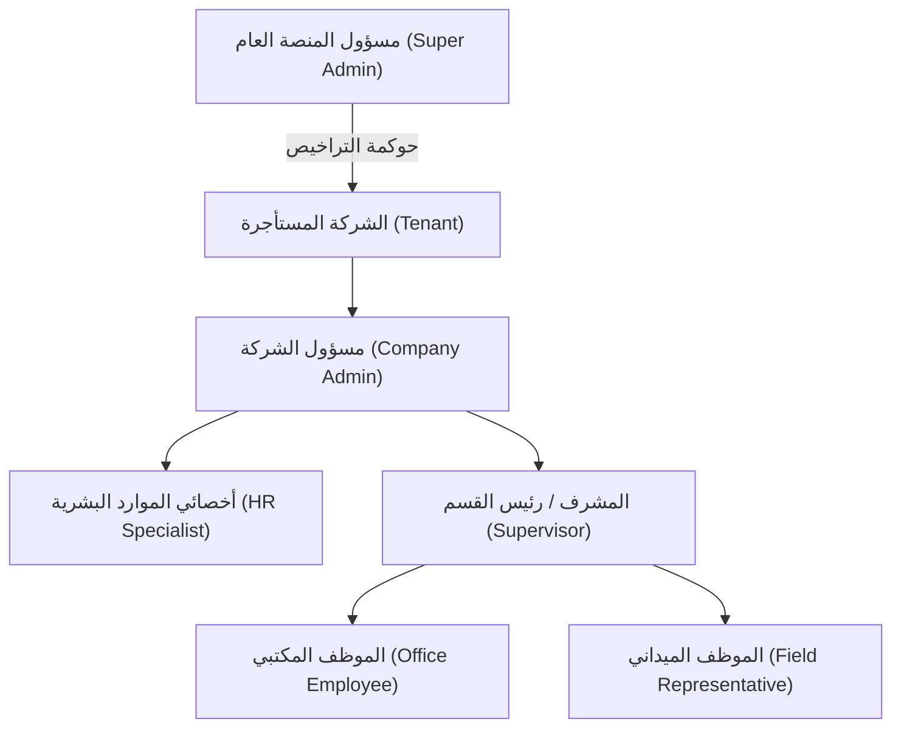
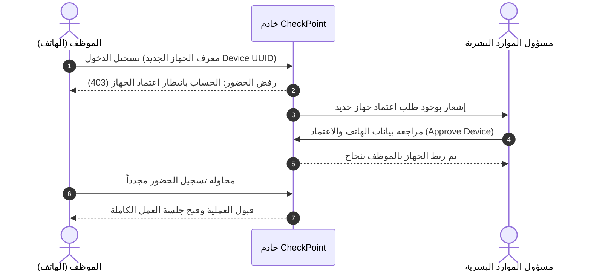
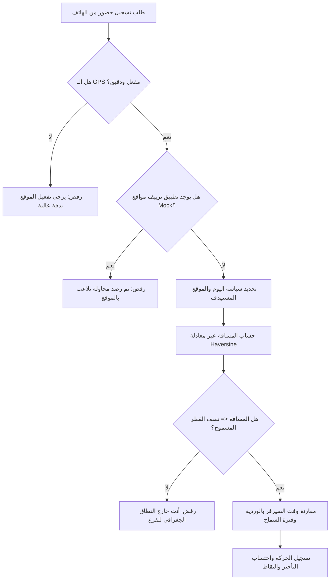
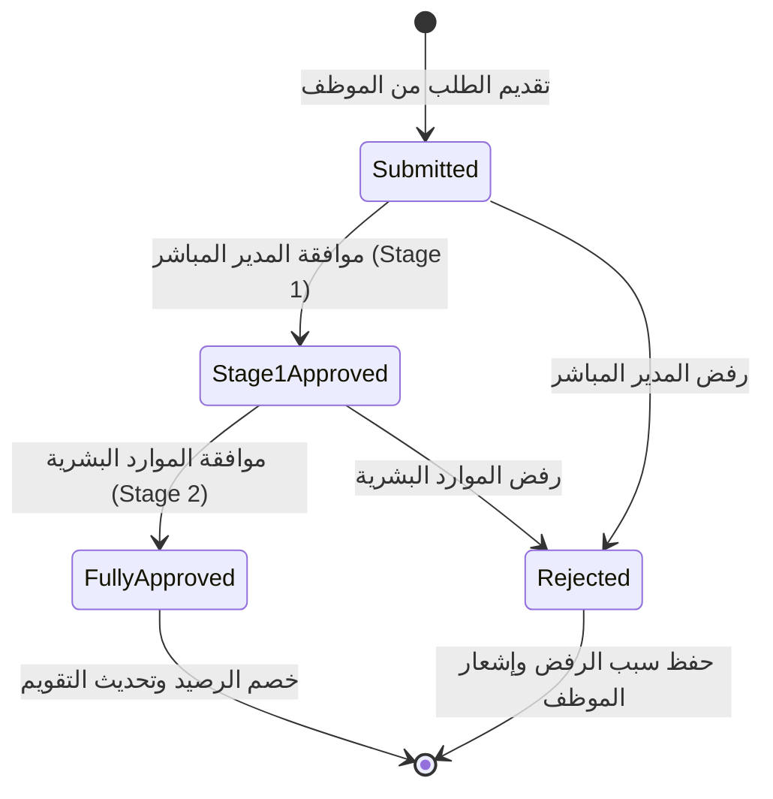

# الموسوعة الشاملة لقواعد وتصميم أعمال نظام CheckPoint HRM
## الدليل المرجعي الكامل للأعمال، السياسات، والعمليات التشغيلية (System Business Bible)
**الجهة المطورة والمالكة:** SYSTM GULF Software Engineering  
**اسم المنصة:** CheckPoint Human Resource & Intelligent Workforce Management Platform  
**تاريخ الإصدار والاعتماد:** نوفمبر 2026 | **حالة الوثيقة:** المرجع الموحد والشامل (Single Source of Truth)

---

## فهرس المحتويات التنفيذي
1. [الرؤية العامة، الأهداف الاستراتيجية ونطاق النظام](#1-الرؤية-العامة-الأهداف-الاستراتيجية-ونطاق-النظام)
2. [بنية تعدد المستأجرين والحوكمة (Multi-Tenancy & Platform Governance)](#2-بنية-تعدد-المستأجرين-والحوكمة-multi-tenancy--platform-governance)
3. [الهيكل التنظيمي، الأدوار، ومصفوفة الصلاحيات (RBAC & Topology)](#3-الهيكل-التنظيمي-الأدوار-ومصفوفة-الصلاحيات-rbac--topology)
4. [إدارة الهوية، الأمان، وربط الأجهزة الفيزيائية (Identity & Device Binding)](#4-إدارة-الهوية-الأمان-وربط-الأجهزة-الفيزيائية-identity--device-binding)
5. [محرك الحضور والانصراف والسياسات اليومية الذكية (Attendance & Policy Engine)](#5-محرك-الحضور-والانصراف-والسياسات-اليومية-الذكية-attendance--policy-engine)
6. [حوكمة النزاعات وتصحيح الحضور (Attendance Dispute & Correction Workflow)](#6-حوكمة-النزاعات-وتصحيح-الحضور-attendance-dispute--correction-workflow)
7. [نظام العمل عن بُعد والعمل الهجين (Remote & Hybrid Work Engine)](#7-نظام-العمل-عن-بُعد-والعمل-الهجين-remote--hybrid-work-engine)
8. [إدارة الإجازات، المغادرات، والتقويم (Leaves, Permits & Holidays)](#8-إدارة-الإجازات-المغادرات-والتقويم-leaves-permits--holidays)
9. [إدارة العمليات الميدانية وخطط العملاء (Field Operations & Customer Visits)](#9-إدارة-العمليات-الميدانية-وخطط-العملاء-field-operations--customer-visits)
10. [إدارة المشاريع، المهام، وخطوط المبيعات (Projects, Tasks & CRM)](#10-إدارة-المشاريع-المهام-وخطوط-المبيعات-projects-tasks--crm)
11. [محرك التحفيز بالألعاب والنقاط وسوق المكافآت (Gamification Engine)](#11-محرك-التحفيز-بالألعاب-والنقاط-وسوق-المكافآت-gamification-engine)
12. [إدارة العمالة، المقاولين، والكشوف الميدانية (Contractors & Worker Roll Call)](#12-إدارة-العمالة-المقاولين-والكشوف-الميدانية-contractors--worker-roll-call)
13. [إدارة العهد والأصول المؤسسية (Enterprise Asset Management)](#13-إدارة-العهد-والأصول-المؤسسية-enterprise-asset-management)
14. [طبقة الذكاء الاصطناعي وبروتوكول سياق النموذج (AI Intelligence & MCP)](#14-طبقة-الذكاء-الاصطناعي-وبروتوكول-سياق-النموذج-ai-intelligence--mcp)
15. [التكاملات المؤسسية وطبقة التوافق (Integrations & Backward Compatibility)](#15-التكاملات-المؤسسية-وطبقة-التوافق-integrations--backward-compatibility)
16. [سجلات التدقيق، الامتثال، وحوكمة البيانات (Audit Trails & Compliance)](#16-سجلات-التدقيق-الامتثال-وحوكمة-البيانات-audit-trails--compliance)

---

## 1. الرؤية العامة، الأهداف الاستراتيجية ونطاق النظام

### 1.1 فلسفة المنصة
نظام **CheckPoint HRM** هو منصة سحابية مؤسسية متكاملة (SaaS) لإدارة رأس المال البشري والعمليات الميدانية الذكية، تم تصميمها وهندستها لتناسب طبيعة الشركات الحديثة التي تعتمد على مزيج من:
1. **العمالة المكتبية (Onsite Workforce):** التي تتطلب انضباطاً جغرافياً دقيقاً وتحققاً من الحضور داخل مقرات وفروع العمل.
2. **الفرق الميدانية والمتحركة (Field & Mobile Workforce):** مثل مندوبي المبيعات، فرق الصيانة، المشرفين على المواقع، وفرق التفتيش.
3. **فرق العمل عن بُعد والعمل الهجين (Hybrid & Remote Teams):** موظفون يعملون من المنزل أو مساحات العمل المشتركة وفق أطر زمنية مرنة.
4. **العمالة المؤقتة ومقاولو الباطن (Contractors & Site Workers):** الذين يعملون في مواقع إنشائية أو تشغيلية دون امتلاك حسابات مستقلة في التطبيقات الذكية.

### 1.2 التحديات والمشاكل الجوهرية المعالجة
* **القضاء على التحايل وتمرير الحضور للزملاء (Zero-Fraud & Anti-Buddy Punching):** حظر تسجيل الحضور من أجهزة متعددة أو عبر برامج تزييف المواقع (Mock GPS) أو تشغيل المحاكيات (Emulators).
* **مرونة الجداول الزمنية (Dynamic Scheduling):** التخلص من القوالب الصلبة (9 إلى 5) وإتاحة سياسات ديناميكية تتغير حسب يوم الأسبوع (مثل: الأحد بالمكتب، الثلاثاء عن بعد، الخميس نصف يوم).
* **الورديات المتقاطعة مع منتصف الليل (Cross-Midnight / Overnight Shifts):** الحساب الرياضي الدقيق لورديات الحراسة والمستشفيات والمصانع التي تبدأ ليلاً وتنتهي صباح اليوم التالي دون إحداث ارتباك في التقويم السنوي.
* **عزل البيانات الصارم (Tenant Data Isolation):** ضمان فيزيائي وقانوني يستحيل معه وصول شركة إلى سجلات شركة أخرى في البيئة السحابية المشتركة.
* **مسارات الاعتماد غير القابلة للكسر (Strict Approval Chains):** حظر التعديل المباشر على الحركات التاريخية دون مسار تدقيق وتصحيح إلكتروني محكم.

### 1.3 أركان النظام التقنية المتكاملة
* **تطبيق الهاتف الذكي (Mobile App):** مبني بتقنية Flutter (لنظامي Android و iOS) ويوفر تجربة استخدام ذاتية سريعة، كشف حيوي، تسجيل فوري، ودعم للعمل بدون إنترنت عند الحاجة.
* **بوابة الشركة والموارد البشرية (Company Web Portal):** مبنية بـ React 18 و Vite وتمنح مدراء الموارد البشرية والمشرفين لوحة تحكم عملياتية شاملة.
* **بوابة مالك المنصة (Super Admin Platform Console):** إدارة اشتراكات الشركات، مراقبة استهلاك الموارد، تفعيل الميزات، وإدارة التراخيص.
* **الخادم السحابي الذكي (Backend Engine):** مبني بتقنية Node.js (Fastify + TypeScript) مع قاعدة بيانات PostgreSQL بنظام Row-Level Security (RLS)، وذاكرة تخزين مؤقت Redis، وطبقة ذكاء اصطناعي عبر Claude LLM وبروتوكول MCP.

---

## 2. بنية تعدد المستأجرين والحوكمة (Multi-Tenancy & Platform Governance)

### 2.1 نموذج العزل الصارم (Row-Level Security - RLS)
يعمل النظام بنموذج **قاعدة بيانات مشتركة بهيكل موحد (Shared Database, Shared Schema)** مدعوماً بحماية على مستوى محرك قاعدة البيانات نفسه (PostgreSQL RLS):
* تحتوي كل الجداول المؤسسية البالغ عددها 38 جدولاً على حقل إلزامي `tenantId`.
* يتم حقن سياق الشركة عبر متغير محلي للجلسة:
  ```sql
  SET LOCAL app.tenant_id = 'company_tenant_id';
  ```
* تفعل قاعدة البيانات سياسة قاطعة:
  ```sql
  CREATE POLICY tenant_isolation_policy ON table_name 
  USING ("tenantId" = current_setting('app.tenant_id', true));
  ```
* **مبدأ الفشل الآمن (Fail-Closed Invariant):** إذا حاول أي استعلام أو كود تشغيلي الوصول إلى قاعدة البيانات دون ضبط مسبق لـ `app.tenant_id`، تعيد قاعدة البيانات **صفر نتائج** تلقائياً، مما يجعل تسريب البيانات مستحيلاً حتى في حال وجود خطأ برمجي.

### 2.2 مصفوفة خطط الاشتراك وسعة التراخيص

| الباقة (Plan Tier) | الحد الأقصى للموظفين | الفروع الجغرافية | محرك السياسات اليومي | الزيارات والمهام الميدانية | الذكاء الاصطناعي و MCP | الحقول المخصصة |
|---|:---:|:---:|:---:|:---:|:---:|:---:|
| **الأساسية (Basic)** | حتى 25 موظفاً | فرع واحد | قياسي فقط | غير متوفر | غير متوفر | غير متوفر |
| **المحترفة (Professional)** | حتى 250 موظفاً | حتى 10 فروع | سياسات كاملة مرنة | متوفر بالكامل | غير متوفر | حقول JSONB قياسية |
| **المؤسسية (Enterprise)** | غير محدود (حسب العقد) | غير محدود | سياسات متقدمة لكل يوم | متوفر بالكامل | متوفر مع حصص استهلاك | دعم كامل للامتدادات |
| **المخصصة (Custom Add-ons)** | سعات خاصة | سعات خاصة | قواعد عمل مخصصة | تكاملات مخصصة | حصص مخصصة وسيرفرات خاصة | مخططات بيانات مخصصة |

### 2.3 حوكمة مقاعد الموظفين (Seat Limit Enforcement)
* يفرض النظام فحصاً ذرياً (Atomic Transaction Check) قبل إضافة أي موظف جديد أو قبول طلب حساب.
* عند بلوغ الحد الأقصى للباقة، يُمنع إنشاء الموظف وتظهر رسالة خطأ صريحة: `TenantSeatLimitExceededError` مع دعوة للتواصل مع المبيعات لترقية الباقة.
* يمكن لمسؤول المنصة (Super Admin) رفع الحد يدوياً أو تعديل الباقة بصلاحية استثنائية.

### 2.4 ميزات المستأجر المخصصة (Custom Tenant Feature Flags)
يتيح النظام تشغيل ميزات خاصة بشركة معينة دون الحاجة لنسخ الكود أو التأثير على باقي الشركات عبر المفتاح `custom.<tenant_feature>` (مثال: `custom.samco_payroll_export`). يتم التحقق من الصلاحية وفق التسلسل:
1. استثناء مخصص للشركة (Tenant Custom Override).
2. استثناء الباقة المشترك بها (Plan Entitlement).
3. التعطيل التلقائي (Disabled by Default).

---

## 3. الهيكل التنظيمي، الأدوار، ومصفوفة الصلاحيات (RBAC & Topology)



### 3.1 تصنيف الأدوار ومسؤولياتها

#### 1. مسؤول المنصة العام (Super Admin - SYSTM GULF):
* إنشاء المستأجرين الجدد وضبط المعرف الخاص بكل شركة (`tenant.slug`).
* مراقبة أداء الخوادم، وسجلات التدقيق العامة، واستهلاك الذكاء الاصطناعي.
* تفعيل وتعطيل الميزات الخاصة والتحكم في باقات الأسعار وفترات التجربة المجانية (Trials).

#### 2. مسؤول الشركة (Company Admin):
* الإعداد الكامل للهيكل المؤسسي (الفروع، الأقسام، الورديات، السياسات).
* التحكم في تعيين الأدوار والصلاحيات للموظفين.
* متابعة تقارير الامتثال والإنتاجية وسجلات التدقيق على مستوى الشركة.
* مراجعة وتجديد اشتراك الشركة.

#### 3. أخصائي الموارد البشرية (HR Specialist):
* مراجعة واعتماد طلبات الحسابات وتفعيل أجهزة الموظفين الجديدة.
* مراجعة وتنفيذ المرحلة الثانية للاعتمادات (إجازات، تصحيح حضور، تسويات نهاية الخدمة).
* إدارة أنواع الإجازات وأرصدة الموظفين وإعداد العطلات الرسمية.
* تخصيص الأصول والعهد ومتابعة استردادها.

#### 4. المشرف ورئيس القسم (Supervisor / Line Manager):
* متابعة الحضور والانصراف اللحظي لأعضاء فريقه.
* اعتماد المرحلة الأولى للإجازات وطلبات العمل عن بُعد والمغادرات القصيرة.
* إسناد المهام، وجدولة خطط العمل الميدانية، ومتابعة إنجاز الزيارات.
* تسجيل الحضور بالنيابة عن أعضاء فريقه في الحالات الاستثنائية المصرح بها.

#### 5. الموظف والمندوب الميداني (Employee / Field Rep):
* تسجيل الحضور والانصراف الذاتي عبر الهاتف مع فحص الموقع والبصمة.
* تقديم طلبات الإجازات، المغادرات، العمل عن بُعد، وتصحيح الحركات.
* استعراض المهام المسندة إليه، تسجيل زيارات العملاء ورفع تقارير الاجتماعات.
* متابعة رصيد النقاط والأوسمة واستبدالها من سوق المكافآت.

### 3.2 التبديل اللحظي بين الأدوار (Multi-Role Switching)
يدعم النظام امتلاك المستخدم لأكثر من دور في نفس الوقت (مثال: موظف يحمل صفة مشرف على فريقه وله حساب موظف عادي أمام مديره).
* تتيح واجهة التطبيق التبديل الحي الفوري (`RoleSwitchDialog`) دون تسجيل الخروج.
* يتم توليد وتحديث رمز الأمان (JWT Token) فورياً مع تفعيل الصلاحيات المناسبة لواجهة الدور الجديد.

### 3.3 سلامة الهيكل الإداري ومنع التبعية الدائرية (Circular Management Guard)
* يمنع النظام برمجياً إنشاء أي علاقة تبعية إدارية دائرية (مثال: لا يمكن للموظف "أ" أن يدير الموظف "ب" إذا كان "ب" يدير "أ" بشكل مباشر أو غير مباشر).
* يتم فحص شجرة التبعية الإدارية باستخدام خوارزميات كشف الحلقات المغلقة (Graph Cycle Detection) قبل حفظ أي تعديل في مدير الموظف.

---

## 4. إدارة الهوية، الأمان، وربط الأجهزة الفيزيائية (Identity & Device Binding)

### 4.1 تشفير بيانات المصادقة وحماية الجلسات
* **تشفير كلمات المرور (Argon2id):** يعتمد النظام خوارزمية Argon2id الرائدة عالمياً (19 ميجابايت ذاكرة، دورتين، خيط معالجة واحد) مع تشفير إضافي (Pepper) على السيرفر.
* **مكافحة تخمين الحسابات (Anti-Enumeration & Constant-Time Response):** في حال محاولة تسجيل الدخول باسم مستخدم غير موجود، يقوم النظام بتنفيذ عملية تشفير وهمية تستغرق نفس الوقت الزمني لمنع المهاجمين من استنتاج وجود الحساب من سرعة الاستجابة.
* **عائلات رموز الأمان (JWT Rotation Families):** استخدام رموز وصول قصيرة الأجل (Access Tokens) مع رموز تجديد مشفرة (Refresh Tokens). في حال إعادة استخدام رمز تجديد قديم، يُلغى فوراً كامل سجل الجلسة حمايةً للحساب من محاولات اعتراض الرموز.

### 4.2 الربط الصارم بالعتاد الفيزيائي للجهاز (Hardware UUID Binding)
لحماية المنظومة من تداول الهواتف وتسجيل الحضور بالنيابة (Buddy Punching):
1. عند أول تسجيل دخول للموظف من تطبيق الموبايل، يلتقط التطبيق المعرف الفريد للجهاز (`App Instance ID` المشتق من عتاد الهاتف).
2. يُسجل الجهاز في قاعدة البيانات بحالة `PENDING` (معلق بانتظار الاعتماد).
3. لا يستطيع الموظف تسجيل الحضور إلا بعد موافقة مسؤول الموارد البشرية على اعتماد هذا الجهاز المادي للموظف.
4. إذا حاول الموظف تسجيل الدخول من هاتف زميله، يرفض النظام العملية فوراً بكود خطأ `403 Device Not Approved`.
5. في حال تغيير الموظف لهاتفه رسمياً، يقدم طلباً إدارياً لإلغاء ربط الجهاز القديم واعتماد الجهاز الجديد.



### 4.3 كشف تزييف المواقع والتلاعب الجغرافي (Mock Location & Anti-Cheat)
* **كشف الـ Mock GPS:** يفحص التطبيق مؤشرات نظام التشغيل التي تفيد بتشغيل تطبيقات تزييف المواقع (Fake GPS) ويمنع العملية فوراً.
* **حماية بيئة التشغيل:** كشف أجهزة الـ Root و Jailbreak ومنع المحاكيات البرمجية (Android Emulators).
* **التكامل مع Google Play Integrity & Apple DeviceCheck:** إرسال بصمة رقمية مشفرة للسيرفر للتحقق من أن التطبيق أصلي ولم يتم التلاعب بملفات الـ APK/IPA.
* **مكافحة التلاعب بالساعة (Time Drift Protection):** لا يعتمد السيرفر على وقت هاتف الموظف مطلقاً في تسجيل حركة الحضور، بل يعتمد حصراً على توقيت السيرفر الذري (NTP Verified Server Time).

---

## 5. محرك الحضور والانصراف والسياسات اليومية الذكية (Attendance & Policy Engine)

### 5.1 محرك السياسات اليومي الذكي (Day-Based Policy Engine)
يتفوق النظام على أنظمة الحضور التقليدية بامتلاك محرك سياسات مرن يدرك خصوصية كل يوم من أيام الأسبوع:
* يمكن للشركة تحديد سياسة عمل مختلفة لكل يوم (مثال: الأحد إلى الأربعاء من 8:00 إلى 16:00، والخميس من 8:00 إلى 14:00، والجمعة والسبت عطلة أسبوعية).
* دعم سياسات المواقع المتغيرة: العمل من المكتب أيام الأحد والاثنين، والعمل عن بعد يوم الثلاثاء، وزيارات ميدانية يومي الأربعاء والخميس.

### 5.2 هرمية حل السياسات التلقائي (Hierarchy of Resolution)
عند قيام الموظف بتسجيل حركة الحضور، يبحث المحرك عن السياسة المطبقة وفق الهرمية التالية (من الأكثر تخصيصاً للأكثر عمومية):
1. **المستوى الأول (جدول الموظف الشخصي):** استثناء محدد للموظف في هذا اليوم تحديداً (`EmployeePolicySchedule`).
2. **المستوى الثاني (سياسة الوردية المخصصة):** السياسة المربوطة بالوردية المسندة للموظف (`ShiftPolicy`).
3. **المستوى الثالث (سياسة الفرع أو الشركة الافتراضية):** السياسة العامة المعتمدة للفرع أو المنظمة.
4. **المستوى الرابع (حالة عدم وجود سياسة):** تسجيل الحركة كحضور حر دون احتساب غرامات أو تأخيرات غير عادلة.

### 5.3 معالجة الورديات المتقاطعة مع منتصف الليل (Overnight Shifts)
في الورديات الليلية (مثل الحراسة من 22:00 ليلاً حتى 06:00 صباحاً):
* يربط النظام حركة الانصراف الصباحية (06:00) بيوم بداية الوردية (البارحة).
* إذا حضر الموظف الساعة 00:30 بعد منتصف الليل، يقوم المحرك باحتسابها كتأخير قدره 150 دقيقة عن وردية الأمس، ولا يعتبرها حضوراً مبكراً جداً لوردية اليوم الجديد.

### 5.4 السياج الجغرافي الذكي (Geofencing Mechanics)
* **السياج الدائري (Circular Geofence):** تحديد إحداثيات الفرع (خط الطول ودائرة العرض) مع نصف قطر مسموح بالأمتار (Radius).
* **حساب المسافة الرياضية الدقيقة:** استخدام معادلة Haversine لحساب المسافة المنحنية على سطح الكرة الأرضية بدقة السنتيمتر.
* **السياج المضلع (Polygon Geofence):** إمكانية رسم مضلع متعدد النقاط لتغطية المنشآت الكبيرة، المصانع، أو المطارات.
* **التحقق المشروط:** لا يمكن للموظف إتمام تسجيل الحضور إذا كانت المسافة المحسوبة تتجاوز نصف القطر المصرح به.



### 5.5 فترات السماح وقواعد الحضور المرن (Grace Period & Flexible Shifts)
* **فترة السماح (Grace Period):** إمكانية تحديد دقائق سماح بعد موعد بداية الوردية (مثلاً 15 دقيقة) لا يُسجل خلالها تأخير على الموظف.
* **الوردية المرنة (Flexible Hours):** تحديد عدد ساعات يومية مطلوبة (مثلاً 8 ساعات) يستطيع الموظف بدءها في أي وقت بين 07:00 و 10:00 صباحاً بشرط إكمال إجمالي الساعات المطلوبة.

---

## 6. حوكمة النزاعات وتصحيح الحضور (Attendance Dispute & Correction Workflow)

### 6.1 حظر التعديل المباشر
لحماية النزاهة المؤسسية والامتثال العمالي، **يُمنع منعاً باتاً التعديل المباشر على حركات الحضور في قاعدة البيانات**. أي تعديل على وقت حركة سابقة أو تسجيل حركة نسيها الموظف يجب أن يمر بمسار تصحيح رسمي.

### 6.2 دورة حياة طلب التصحيح
1. **إنشاء الطلب:** يقوم الموظف (أو مديره) بتقديم طلب تصحيح حركة حضور أو انصراف مع بيان السبب وإرفاق الإثباتات إن وجدت.
2. **تجميد البيانات السابقة (Historical Diff Snapshot):** يُخزن النظام القيم القديمة قبل التعديل في حقول مخصصة (`originalClockIn`, `originalClockOut`).
3. **الاعتماد الإداري:** يُعرض الطلب على المسؤول المباشر أو الموارد البشرية.
4. **حظر الموافقة الذاتية:** لا يمكن لأي مسؤول اعتماد طلب تصحيح مقدم لنفسه.
5. **التنفيذ وإعادة الاحتساب:** عند الاعتماد، يقوم النظام بتعديل السجل ووسمه بـ `isManualEntry = true`، ثم يُطلق محرك السياسات تلقائياً لإعادة احتساب دقائق التأخير، والانصراف المبكر، ونقاط الحضور بناءً على الأوقات المعتمدة الجديدة.

---

## 7. نظام العمل عن بُعد والعمل الهجين (Remote & Hybrid Work Engine)

### 7.1 الحوكمة والحدود القصوى
* **السقف الأسبوعي (Weekly Remote Cap):** تحديد الحد الأقصى لأيام العمل عن بُعد المسموحة لكل موظف أسبوعياً (مثلاً يومان في الأسبوع).
* **الأيام المصرح بها:** تحديد أيام أسبوعية محددة يجوز العمل فيها عن بُعد (مثلاً منع العمل عن بعد يومي الأحد والخميس).
* **الاعتماد المسبق:** لا يمكن للموظف تسجيل حضور عن بعد إلا بعد تقديم طلب واعتماده من المشرف المباشر.

### 7.2 تسجيل الحضور عن بُعد
* عند تفعيل صلاحية العمل عن بعد لليوم، يُعفى الموظف من شرط التواجد داخل النطاق الجغرافي للفرع.
* يستمر النظام في التقاط الإحداثيات الحقيقية لمكان العمل لأغراض الشفافية وإثبات النشاط.

---

## 8. إدارة الإجازات، المغادرات، والتقويم (Leaves, Permits & Holidays)

### 8.1 مسار الاعتماد ثنائي المراحل (Two-Stage Approval Workflow)
تخضع طلبات الإجازات لمسار موافقات تسلسلي محكم:


### 8.2 تصنيف الإجازات وقواعد الاستحقاق
1. **الإجازة الاعتيادية السنوية (Annual Leave):** تُخصم من الرصيد السنوي المستحق (مثلاً 21 أو 30 يوماً).
2. **الإجازة المرضية (Sick Leave):** تتطلب إرفاق تقرير طبي معتمد ولها سقف سنوي منفصل وفق قانون العمل.
3. **الإجازات الخاصة بأحداث الحياة:** (إجازة زواج، إجازة وفاة، إجازة وضع/أمومة، إجازة أداء فريضة الحج).
4. **الإجازة بدون راتب (Unpaid Leave):** لا تخصم من الرصيد السنوي لكنها تؤثر على احتساب مسيرات الرواتب.

### 8.3 التحقق التلقائي لمنع التعارض والرصيد السالب
* **منع التداخل (Overlap Prevention):** يرفض النظام برمجياً أي طلب إجازة يتداخل تاريخه مع إجازة أخرى معتمدة أو معلقة لنفس الموظف.
* **منع الرصيد السالب:** لا يمكن تقديم طلب إجازة إذا كان عدد الأيام المطلوبة يتجاوز الرصيد المتبقي المتاح للموظف في تلك السنة المالية.

### 8.4 تصاريح المغادرة القصيرة (Short Permits)
* **المغادرة أثناء الدوام (Mid-day Permit):** تصريح خروج لمهام طارئة والعودة قبل نهاية اليوم.
* **تصريح التأخير المسبق (Late Arrival Permit):** إشعار مسبق بتأخر معتمد لا يترتب عليه تسجيل عقوبة تأخير.
* **تصريح الانصراف المبكر (Early Departure Permit):** إنهاء الدوام مبكراً لظرف معتمد.
* تحسب دقائق المغادرات ضمن تقارير الالتزام الإجمالية للمنشأة.

---

## 9. إدارة العمليات الميدانية وخطط العملاء (Field Operations & Customer Visits)

### 9.1 خطط العمل الميدانية اليومية (`WorkPlan`)
* يقوم المشرف بإعداد خطة عمل ميدانية لفريقه أو لموظف محدد لتغطية منطقة جغرافية أو قائمة عملاء.
* ترتبط الخطة بتاريخ محدد ومستهدفات واضحة.

### 9.2 زيارات العملاء الميدانية (`CustomerPlan`)
1. **دليل العملاء ونقاط البيع:** تسجيل بيانات العميل، رقم الهاتف، والموقع الجغرافي الدقيق لفرع أو متجر العميل.
2. **بدء الزيارة الميدانية (Check-In at Customer):** يصل المندوب لمتجر العميل ويسجل بدء الزيارة مع فحص الإحداثيات للتأكد من وجوده الفعلي لدى العميل.
3. **توثيق مخرجات الزيارة:** تسجيل ملاحظات الاجتماع، والتقاط صور الرفوف أو المستندات، وتحديد نتيجة المقابلة.
4. **إنهاء الزيارة (Check-Out):** احتساب مدة الزيارة وتوثيق تقييم العميل أو مستوى الرضا.

---

## 10. إدارة المشاريع، المهام، وخطوط المبيعات (Projects, Tasks & CRM)

### 10.1 لوحات المهام والكانبان (Kanban Board)
* تنظيم مهام الفرق في أعمدة مرئية: (قيد الانتظار `To Do`، قيد التنفيذ `In Progress`، تحت المراجعة `Review`، مكتملة `Done`).
* إمكانية تحديد درجات الأهمية: منخفضة، متوسطة، عالية، وحرجة (Urgent).
* دعم قوائم التحقق الفرعية (Checklists) لتتبع الخطوات التفصيلية لكل مهمة ونسبة الإنجاز المئوية.

### 10.2 احتساب التأخير الديناميكي (Derived Overdue Status)
* لتجنب الحقول الراكدة في قاعدة البيانات، لا تُخزن حالة "متأخرة" كقيمة جامدة، بل تُشتق ديناميكياً في الاستعلامات:
  $$\text{IsOverdue} = (\text{DueDate} < \text{Now}) \land (\text{Status} \neq \text{'Done'})$$
* يضمن ذلك دقة التقارير اللحظية دون الحاجة لتشغيل وظائف دورية متكررة (Cron Jobs) لتحديث الحقول.

### 10.3 خطوط المبيعات ومتابعة العملاء المحتملين (Sales Lead Pipeline)
مسار مبيعات احترافي لتحويل الفرص إلى صفقات رابحة:
$$\text{New Lead} \longrightarrow \text{Contacted} \longrightarrow \text{Demo Scheduled} \longrightarrow \text{Proposal Sent} \longrightarrow \text{Won / Lost}$$

---

## 11. محرك التحفيز بالألعاب والنقاط وسوق المكافآت (Gamification Engine)

### 11.1 فلسفة التحفيز
تحويل الالتزام الوظيفي والانضباط اليومي من مجرد قيود روتينية إلى تجربة محفزة وممتعة من خلال نظام مكافآت تنافسي شفاف.

### 11.2 مصفوفة احتساب النقاط التلقائية

| الحدث أو الإجراء | نوع النقاط | القيمة الافتراضية | المعيار والشرط |
|---|:---:|:---:|---|
| **حضور مبكر أو في الموعد تماماً** | إيجابية (+) | +10 نقاط | تسجيل الحضور قبل بداية الوردية بـ 5 دقائق أو في الموعد |
| **إتمام أسبوع عمل كامل بدون أي تأخير** | إيجابية (+) | +50 نقطة | 5 أيام متتالية دون تسجيل دقيقة تأخير واحدة |
| **إتمام مهمة ميدانية بنجاح** | إيجابية (+) | +20 نقطة | إنهاء المهمة قبل موعد استحقاقها النهائي |
| **زيارة عميل بتقييم ممتاز** | إيجابية (+) | +15 نقطة | توثيق زيارة مع تقييم إيجابي من العميل |
| **تأخير عن موعد بداية الوردية** | خصم (-) | -5 إلى -20 نقطة | خصم تصاعدي بحسب مدة التأخير بعد فترة السماح |
| **غياب غير مبرر بدون إذن مسبق** | خصم (-) | -50 نقطة | انقضاء الوردية دون تسجيل حضور أو طلب إجازة |
| **نسيان تسجيل الانصراف** | خصم (-) | -10 نقاط | إغلاق اليوم تلقائياً دون تسجيل خروج |

### 11.3 مستويات الموظفين والأوسمة (Tiers & Badges)
* **المستويات التنافسية:**
  1. برونزي (0 - 500 نقطة)
  2. فضي (501 - 1500 نقطة)
  3. ذهبي (1501 - 3000 نقطة)
  4. بلاتيني (أكثر من 3000 نقطة)
* **أوسمة التميز الرقمية (Badges):** وسام الانضباط الذهبي، وسام بطل الميدان، وسام الإنجاز السريع.

### 11.4 سوق استبدال النقاط (Points Store & Rewards)
* متجر داخلي مخصص لكل شركة تستطيع إدارة مكافآتها الخاصة (أيام إجازة إضافية، بطاقات هدايا، قسائم شراء، مكافآت عينية أو مالية).
* يطلب الموظف استبدال نقاطه بمكافأة، ويخضع الطلب لاعتماد إدارة الموارد البشرية قبل الصرف.
* لوحة متصدرين (Leaderboard) تعرض الموظفين الأكثر التزاماً وتفوقاً على مستوى القسم أو الشركة كاملة.

---

## 12. إدارة العمالة، المقاولين، والكشوف الميدانية (Contractors & Worker Roll Call)

### 12.1 إدارة مقاولي الباطن والعمالة المؤقتة
في المشاريع الإنشائية والتنفيذية، يعمل مئات العمال التابعين لشركات مقاولات باطن، ولا يمتلكون هواتف ذكية أو حسابات بالبريد الإلكتروني:
* يتيح النظام تسجيل شركات المقاولات المساندة وربطها بالمشاريع المفتوحة.
* تسجيل بيانات بطاقات الهوية الوطنية أو الإقامات للعمالة التابعة لكل مقاول.

### 12.2 الكشوف الميدانية الجماعية (Worker Roll Call)
* يقوم المشرف الميداني المسؤول عن الموقع بفتح شاشة **حصر الحضور الجماعي (Roll Call)** على جهازه المحمول.
* استعراض قائمة عمال المقاول في الموقع وتأكيد حضور كل عامل بنقرة زر واحدة أو بمسح الباركود/بطاقة العمل.
* توثيق إجمالي ساعات عمل الوردية للعمالة لاعتماد مستخلصات مقاولي الباطن المالية بدقة ومنع الفواتير الوهمية.

---

## 13. إدارة العهد والأصول المؤسسية (Enterprise Asset Management)

### 13.1 تصنيف العهد والأصول
إدارة شاملة لكافة الأجهزة والمعدات الموزعة على موظفي الشركة:
* أجهزة إلكترونية (لابتوب، هاتف، تابلت، شاشات).
* سيارات ومركبات الشركة.
* بطاقات الوقود، شرائح الاتصال، وأجهزة الدفع المحمولة.

### 13.2 دورة حياة تسليم واسترداد الأصل
* **حظر التخصيص المزدوج:** يستحيل برمجياً تسليم أصل لموظف إذا كان مسجلاً كعهدة بحوزة موظف آخر لم يتم استردادها رسمياً.
* **توثيق الحالة:** تسجيل حالة الأصل عند التسليم (جديد، ممتاز، جيد) ومطابقتها مع حالته عند الاسترداد.
* **إثبات الفقدان أو التلف:** مسار خاص لتسجيل تلف العهدة وتحديد المسؤولية المالية المترتبة عليها وفق اللوائح الداخلية.

---

## 14. طبقة الذكاء الاصطناعي وبروتوكول سياق النموذج (AI Intelligence & MCP)

### 14.1 كشف الاحتيال الذكي وقواعد الفيزياء القطعية (Deterministic Rules First)
قبل استهلاك أي رمز ذكاء اصطناعي (LLM Token)، يعتمد النظام على خوارزميات رياضية قطعية مكتوبة بكود TypeScript الصارم:
* **حساب سرعة الانتقال المستحيلة (Impossible Travel Speed):** إذا سجل موظف حضوراً في القاهرة، ثم سجل حركة بعد نصف ساعة في الرياض، يحسب النظام السرعة المطلوبة لقطع هذه المسافة ($> 800\text{ km/h}$) ويصنف الحركة تلقائياً كاحتيال مكاني مؤكد.
* **رصد الأنماط الزمنية المتطابقة:** كشف البصمات الجماعية المتطابقة بالثانية بين عدة موظفين.

### 14.2 بروتوكول سياق النموذج (Model Context Protocol - MCP)
يوفر النظام أول تطبيق عملي لمعيار الـ MCP المؤسسي لربط مساعدي الذكاء الاصطناعي (Claude Desktop, Cursor, Antigravity, VS Code) ببيانات الموارد البشرية:
* **الأمان والعزل التام:** خادم الـ MCP يعمل بنمط القراءة فقط للمعلومات العامة والحضور، ويقوم السيرفر داخلياً بحقن `tenantId` الخاص بالمستخدم دون السماح للذكاء الاصطناعي بتخمين أو تعديل هوية الشركة.
* **طرق المصادقة المدعومة:**
  1. **المصادقة الحديثة OAuth 2.0 PKCE:** تفويض مباشر وتلقائي عبر المتصفح بنقرة زر واحدة دون الحاجة لنسخ أكواد.
  2. **رموز الوصول الشخصية (Personal Access Tokens - PAT):** توليد رموز مشفرة للمطورين مع صلاحيات منتهية الصلاحية.
* **الأدوات المتاحة لوكلاء الذكاء الاصطناعي:**
  * `get_my_attendance`: استعلام الموظف عن سجلات حضوره وانصرافه لفترة محددة.
  * `get_leave_balance`: استعلام الموظف عن رصيد إجازاته المتبقية والمستهلكة.
  * `list_pending_approvals`: استعراض طلبات الإجازات والمغادرات المعلقة بانتظار اعتماد المدير.
  * `search_employees`: دليل الموظفين والبحث بالاسم أو الكود الوظيفي أو القسم.

---

## 15. التكاملات المؤسسية وطبقة التوافق (Integrations & Backward Compatibility)

### 15.1 التكامل اللحظي مع نظام Odoo ERP
يدعم النظام مزامنة آلية ثنائية الاتجاه مع نظام Odoo الشهير:
* سحب سجلات الموظفين، الأقسام، والمسميات الوظيفية من Odoo إلى CheckPoint.
* إرسال حركات الحضور والانصراف المعتمدة يومياً إلى موديول `hr_attendance` في Odoo.
* مزامنة الإجازات والعطلات الرسمية المعتمدة مع موديول `hr_holidays`.

### 15.2 خدمة الإشعارات اللحظية الفورية (Firebase Cloud Messaging - FCM)
* إرسال إشعارات فورية لهواتف الموظفين عند: (اعتماد أو رفض طلب إجازة، استلام مهمة جديدة، تذكير ببداية ونهاية الوردية).
* دعم ترجمة الإشعارات للغتين العربية والإنجليزية تلقائياً بحسب لغة جهاز الموظف.

### 15.3 طبقة التوافق العكسي مع تطبيقات الهاتف القديمة (`/api/v1`)
* لحماية التطبيقات المشحونة في هواتف الموظفين من التوقف، يحتوي الخادم على طبقة توافق كاملة تحاكي خادم `.NET EMS.Blazor 1.0` القديم.
* تقوم هذه الطبقة بترجمة بيانات الـ ISO الحديثة إلى صيغ `.NET Ticks` و `TimeOnly` التاريخية واستنتاج هوية الشركة تلقائياً من معرف الجهاز `mobileId` دون أي تعديل على هواتف المستخدمين.

---

## 16. سجلات التدقيق، الامتثال، وحوكمة البيانات (Audit Trails & Compliance)

### 16.1 سجل التدقيق غير القابل للتعديل (Immutable Audit Log)
* تسجل المنظومة كل عملية حساسة تحدث على النظام في جدول تدقيق دائم ومحمي من التعديل أو الحذف (`audit_logs`).
* **البيانات الموثقة في كل حركة:**
  * معرف الشركة والمستخدم المنفذ للعملية (`actorId`).
  * عنوان الإنترنت الحقيقي (`ipAddress`) وبيانات المتصفح/الجهاز (`userAgent`).
  * اسم الوحدة ونوع الإجراء (`action`: إنشاء، تعديل، حذف، اعتماد، رفض).
  * لقطة مقارنة البيانات قبل وبعد الإجراء (`beforeState` و `afterState`).

### 16.2 سياسات الحذف الآمن (Soft Delete Principle)
* لا تُحذف أي بيانات وظيفية (موظفين، حركات حضور، طلبات، فروع) بشكل نهائي من قاعدة البيانات عند قيام المسؤول بحذفها.
* يتم وسم السجل بـ `deletedAt = NOW()` واستبعاده من واجهات الاستخدام العادية، مع بقائه متاحاً لأغراض التحقيق القانوني والمراجعة الجنائية لسجلات الشركة.

---

## خاتمة وثيقة الأعمال
تُمثل هذه الوثيقة **الدستور الشامل والكامل لكافة منطق وقواعد أعمال نظام CheckPoint HRM**. تم تصميم كل قاعدة وكل خوارزمية فيها لتحقيق أعلى درجات الأمان، الإنتاجية، وسهولة الاستخدام للشركات، مع قابلية توسع سحابية فائقة تستوعب مئات الآلاف من الموظفين دون أي مساس بسلامة واستقلالية بيانات كل منظمة.
