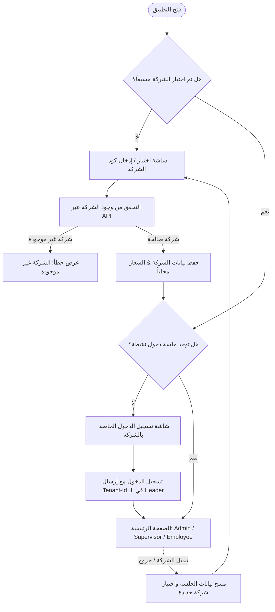

# CheckPoint HRMS - System Architecture & Multi-Tenant Transformation Guide

---

## 1. نظرة عامة على النظام (System Architecture Overview)

تطبيق **CheckPoint HRMS (v2)** هو نظام شامل لإدارة الموارد البشرية، الحضور والانصراف، المهام، وإدارة الفروع والفرق، مبني باستخدام **Flutter** وفق مبادئ **Clean Architecture** ونظام طبقات منظم:

```text
┌─────────────────────────────────────────────────────────┐
│                   Presentation Layer                    │
│   (Screens, Small Composed Widgets, Cubits & States)    │
├─────────────────────────────────────────────────────────┤
│                   Domain Layer (Optional)               │
│   (UseCases for complex multi-step business logic)      │
├─────────────────────────────────────────────────────────┤
│                      Data Layer                         │
│   (Retrofit API Services, DTO Models, Repository Impl)  │
├─────────────────────────────────────────────────────────┤
│                      Core Layer                         │
│   (DI GetIt, Dio, Routing, Theming, Storage, L10n)      │
└─────────────────────────────────────────────────────────┘
```

### 🛠️ المكدس التقني (Tech Stack):
- **إدارة الحالة (State Management):** `flutter_bloc` (Cubits) مع حالات مبنية بـ `freezed`.
- **الشبكات والتواصل (Networking):** `dio` + `retrofit` مع معالجة استجابات عبر `ApiResult<T>` و `ApiFailureMapper`.
- **حقن التبعيات (Dependency Injection):** `get_it` في ملف مركزي `lib/core/di/service_locator.dart`.
- **التخزين المحلي (Local Storage):** 
  - `flutter_secure_storage`: للرموز الحساسة (Tokens, Biometrics, Session).
  - `shared_preferences`: للإعدادات غير الحساسة وتفضيلات اللغة.
- **التوجيه (Routing):** `Navigator 1.0` مركزي مع `onGenerateRoute` في `lib/core/routes/app_router.dart` وثوابت مسارات `AppRoutes`.
- **التصميم والأبعاد (Design & Sizing):** `flutter_screenutil_plus`، ونظام ألوان وخطوط مركزي في `lib/core/styles/`.
- **الترجمة واللغات (Localization):** `easy_localization` (العربية `ar`، الإنجليزية `en`، والمصرية `ar-EG`).

---

## 2. تفصيل ميزات ووحدات النظام (Core Modules Breakdown)

### 🔐 1. وحدة المصادقة والجلسات (`features/auth`)
- **تسجيل الدخول (`LoginScreen` / `LoginCubit`):**
  - يدعم تسجيل الدخول بـ (Username / Email + Password).
  - يدعم اختيار وتحديد الدور (`Admin`, `Supervisor`, `Employee`).
  - فحص هوية الجهاز الفريدة (`MobileId` / `DeviceId`) وربطها بالجلسة.
  - دعم قفل الحساب عند تكرار المحاولات الخاطئة (`errors.accountLocked`).
  - طلب نقل الحساب لجهاز جديد (`Device Transfer Request`).
- **المصادقة البيومترية (`BiometricAuthService`):**
  - تفعيل الدخول ببصمة الإصبع أو الوجه وتخزين الجلسة المشفرة.
- **إدارة الجلسات والرموز (`AuthSessionStorage`):**
  - تخزين JWT Access Token وفك ترميز المطالبات (Claims: `sub`, `employeeId`, `tenantId`, `roles`, `permissions`).
- **طلبات فتح الحسابات (`RequestAccessScreen` / `RequestAccountCubit`):**
  - إرسال طلب انضمام للمسؤول برقم هوية الجهاز التلقائي، ومتابعة حالة الطلب (معلق / مقبول / مرفوض).

---

### 👨‍💼 2. وحدة لوحة تحكم المسؤول (`features/admin`)
لوحة تحكم إدارية كاملة تغطي كافة عمليات الشركة:
1. **إدارة الموظفين (`AdminEmployeesScreen`):**
   - استعراض، بحث بالاسم/الكود، فلترة حسب الأدوار (Admin, Supervisor, Employee).
   - **إنشاء موظف جديد (`AdminCreateEmployeeScreen`):** معالج متعدد الخطوات (Personal, Work, Shift, Role).
   - **الملف الشخصي للموظف (`AdminEmployeeProfileScreen`):**
     - **Job Tab:** المسمى الوظيفي، القسم، الفرع، الوردية، نظام العمل (حضوري/عن بعد/هجين)، المدير المباشر، تواريخ التعيين والعقود.
     - **Personal Tab:** الرقم القومي، جواز السفر، الهاتف، البريد، تاريخ الميلاد، الحالة الاجتماعية، جهات اتصال الطوارئ.
     - **Payroll & Bank Tab:** الراتب الأساسي، البدلات، الحساب البنكي، الـ IBAN، الرقم التأميني.
     - **Docs & Security Tab:** رفع وإدارة وحذف المستندات الرسمية (عقد العمل، شهادة التخرج، الفيش الجنائي، استمارة التأمينات، مستندات إضافية).
     - **صلاحيات الـ RBAC:** تعيين وعرض صلاحيات الموظف الدقيقة.
     - **الأجهزة المسجلة:** استعراض واعتماد ورفض أجهزة الموظف.
   - **سلة المحذوفات للموظفين (`AdminDeletedEmployeesScreen`):** استعراض الموظفين المحذوفين مع إمكانية **الاستعادة الفورية** أو **الحذف النهائي**.
2. **إدارة الهيكل التنظيمي (`AdminLocationsScreen` / `AdminDepartmentsScreen`):**
   - **الأقسام (Departments):** إضافة وحذف وتعديل الأقسام واستعراض موظفي كل قسم.
   - **الفروع (Branches):** تحديد موقع الفرع على الخريطة مع النطاق الجغرافي (Geofence Radius).
   - **العملاء والمواقع الخارجية (Customers/Sites):** إدارة مواقع العملاء لموظفي الزيارات والمشاريع.
3. **الورديات وسياسات العمل (`AdminShiftsPoliciesScreen`):**
   - إنشاء الورديات، تحديد مواعيد البداية والنهاية، فترات السماح للتأخير، وتعيين الموظفين عليها.
   - إدارة سياسات العمل عن بعد ونظام العمل الهجين.
4. **مراقبة الحضور والعمليات (`AdminAttendanceScreen`):**
   - سجل الحضور الحي لكافة الموظفين، الفلاتر الزمنية، رصد الغياب والتأخير وساعات العمل.
   - إضافة/تعديل/حذف سجلات الحضور يدوياً.
5. **المهام والخطط (`AdminTasksScreen` / `AdminPlansScreen`):**
   - إنشاء وتوزيع المهام وخطط الزيارات وتتبع الإنجاز.
6. **إدارة طلبات الإجازات (`AdminLeaveManagementScreen`):**
   - مراجعة طلبات الإجازات، الموافقة، أو الرفض مع ذكر السبب.
7. **سجل التدقيق والأمان (`AdminEmployeeAuditScreen` / `AdminDevicesScreen`):**
   - تتبع سجل كافة العمليات التي تمت في النظام (Audit Logs).
   - إدارة طلبات اعتماد الأجهزة الجديدة للموظفين.

---

### 👷 3. وحدة الموظف (`features/employee`)
- **تسجيل الحضور والانصراف الذكي (`EmployeeClockScreen`):**
  - التحقق من النطاق الجغرافي للفرع عبر GPS (`AttendanceVerificationService`).
  - دعم تسجيل الحضور الذاتي أو وفق خطة عمل معتمدة.
  - دعم التحقق البيومتري عند الحضور.
  - دعم العمل بدون اتصال وعبر منصة Odoo (`OdooAttendanceService`).
- **سجل الحضور الشهري:** استعراض أوقات الحضور والانصراف، ساعات العمل اليومية، والـ Overtime.
- **المهام وخطط العمل:** متابعة المهام المسندة، تحديث حالتها، وتقديم تقارير الإنجاز (Feedback).
- **العمل عن بعد (`features/remote_work`):** فحص إمكانية العمل عن بعد وفق السياسة المعتمدة وتجاوز قيود الموقع عند السماح.

---

### 🕵️‍♂️ 4. وحدة المشرف (`features/supervisor`)
- **إدارة فريق العمل المباشر:** استعراض حالة الفريق اليوم (حاضر / غائب / في إجازة / في مهمة).
- **تسجيل الحضور بالنيابة (Site Clock-In):** إمكانية تسجيل حضور أحد أفراد الفريق في الموقع عبر بصمة المشرف أو التحقق الجغرافي.
- **توزيع المهام والخطط:** إسناد مهام وزيارات لأعضاء الفريق ومتابعة سير تنفيذها.
- **اعتماد الإجازات والاستئذانات:** الموافقة المبدئية أو النهائية على طلبات الفريق.

---

### 🏖️ 5. وحدة الإجازات والاستئذانات (`features/leaves`)
- استعراض أرصدة الإجازات المتبقية (سنوية، عارضة، مرضية).
- تقديم طلب إجازة وتحديد المدة ونوع الإجازة والبديل.
- تقديم طلبات الاستئذان الساعي (Short Leaves / Permissions).
- استعراض العطلات الرسمية القادمة (`UpcomingHolidayCubit`).

---

### 📊 6. وحدة المشاريع والإشعارات (`features/projects` & `features/notifications`)
- لوحة إدارة المشاريع وتتبع الساعات الإنتاجية.
- الإشعارات الفورية (Push Notifications) وسجل التنبيهات داخل التطبيق.

---

## 3. تحليل الوضع الحالي للـ Multi-Tenancy في الكود

### ما هو موجود حالياً:
1. **الـ Base URL:** معرف حالياً كعنوان ثابت أو عبر متغيرات بيئة `Env.baseUrl` في `lib/core/app/app_config.dart`.
2. **الـ Tenant ID:** يتم تمريره حالياً كـ Claim داخل الـ JWT Token بعد تسجيل الدخول، أو يُقرأ من جلسة المستخدم `tenantId: "demo-tenant-000000000000"`.
3. **الـ Interceptor:** `AuthTokenInterceptor` يقوم بحقن الـ `Authorization: Bearer <token>` فقط.

---

## 4. المخطط الهندسي للتحول إلى نظام متعدد الشركات (Multi-Tenant Architecture)



---

## 5. دليل خطوات التنفيذ البرمجي للـ Multi-Tenant (Implementation Blueprint)

### الخطوة 1: طبقة التخزين المحلي للشركة (`TenantStorage`)
إنشاء كلاس لإدارة الشركة المحددة محلياً:
- تخزين: `tenantId`, `tenantCode`, `companyName`, `companyLogoUrl`, `customBaseUrl` (إن وجد).

```dart
// lib/core/tenant/tenant_storage.dart
class TenantStorage {
  // saveTenant, getTenant, clearTenant, hasTenant
}
```

### الخطوة 2: تعديل الـ Network Interceptor لحقن الـ Tenant تلقائياً
تعديل `DioFactory` لإضافة `TenantInterceptor` أو دمجها في `AuthTokenInterceptor`:
- إضافة Header إجباري في كافة الطلبات:
  ```http
  X-Tenant-Id: <CURRENT_TENANT_ID_OR_CODE>
  ```
- أو تغيير `options.baseUrl` ديناميكياً إذا كان لكل شركة Subdomain خاص (مثل: `https://company1.checkpoint.com/api`).

### الخطوة 3: إنشاء ميزة التحقق من الشركة (`features/tenant_lookup`)
1. **Data Layer:**
   - `TenantApiService`: ميثود `GET /api/Tenant/lookup/{companyCode}` أو `POST /api/Tenant/verify`.
   - `TenantModel`: يحمل بيانات الشركة (ID، الاسم، الشعار، الثيم، الحالة).
   - `TenantRepo`: تنفيذ استدعاء السيرفر والتحقق.
2. **Presentation Layer:**
   - `TenantLookupCubit` & `TenantLookupState`.
   - `TenantLookupScreen`: شاشة عصرية تدخل كود أو اسم الشركة مع إظهار شعار الشركة فور التحقق.
   - خيار مسح/تغيير الشركة (Change Company) متاح دائماً في شاشة تسجيل الدخول.

### الخطوة 4: مسار الإقلاع في `AppRouter` و `AppLaunchLogic`
تحديث مسار البداية في التطبيق:
```dart
// منطق التحقق الأولي:
final hasTenant = await sl<TenantStorage>().hasTenant();
if (!hasTenant) {
  return AppRoutes.tenantLookup;
}
final isLoggedIn = await sl<AuthSessionStorage>().hasValidSession();
if (isLoggedIn) {
  return AppRoutes.home;
}
return AppRoutes.login;
```

### الخطوة 5: دعم التبديل السلس بين الشركات (Multi-Account / Tenant Switcher)
- عند تسجيل الخروج أو الضغط على "تسجيل الدخول لشركة أخرى":
  - مسح جلسة المستخدم والـ Token.
  - إما مسح الشركة المختارة أو العودة لشاشة اختيار الشركة.

---

## 6. جدول مقارنة المسارات والبيانات (Before & After)

| العنصر | قبل التحويل (Current Single-Tenant) | بعد التحويل (Multi-Tenant Architecture) |
| :--- | :--- | :--- |
| **أول شاشة تفتح** | `LoginScreen` مباشرة مع افتراض Tenant ثابت | `TenantLookupScreen` لإدخال كود/نطاق الشركة |
| **هيدر الشبكة** | `Authorization: Bearer <token>` | `Authorization` + `X-Tenant-Id: <company_id>` |
| **واجهة الدخول** | واجهة عامة موحدة | واجهة مخصصة تعرض اسم وشعار الشركة المختارة |
| **تخزين الجلسة** | توكن المستخدم وبيانات الموظف | بيانات الشركة + توكن المستخدم المرتبط بالشركة |
| **التحقق من الشركة** | ضمني في الباك إند | استعلام مسبق للتحقق من وجود وصلاحية اشتراك الشركة |

---
