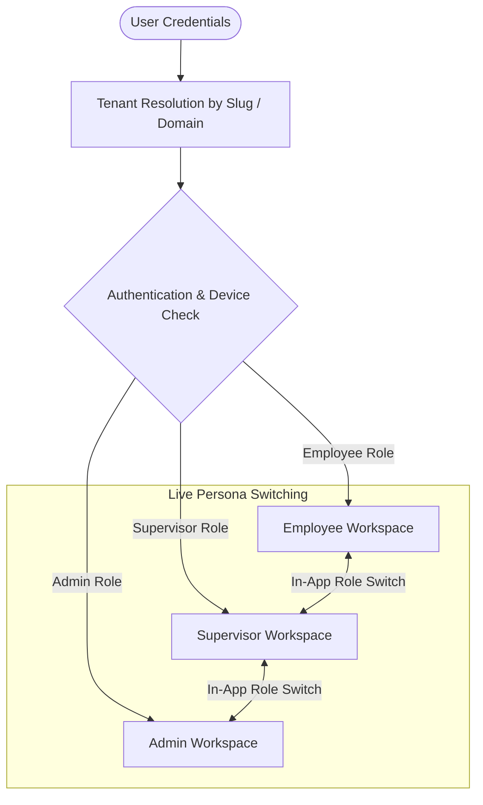
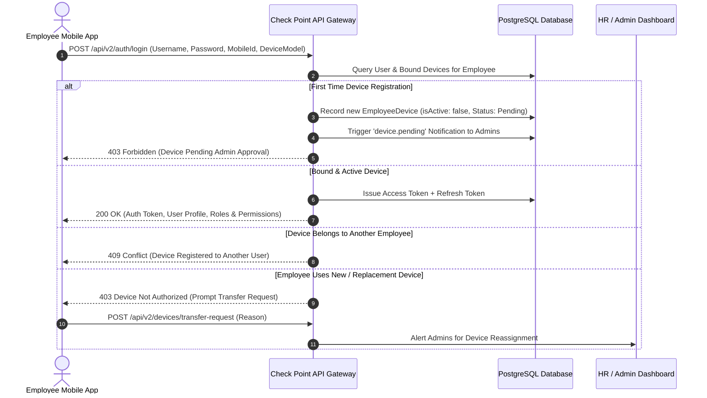
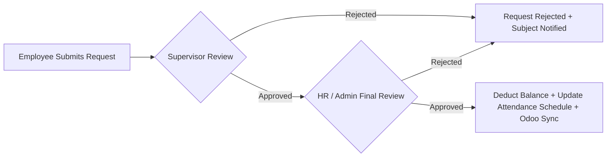
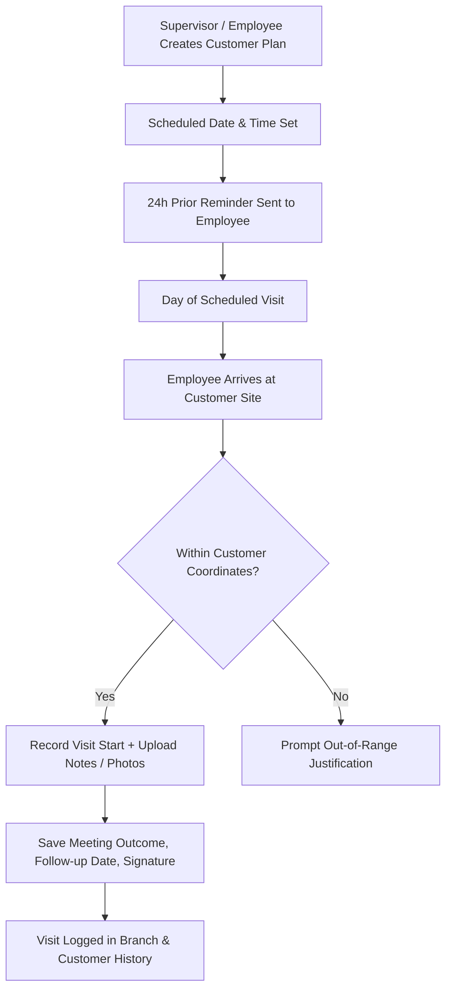
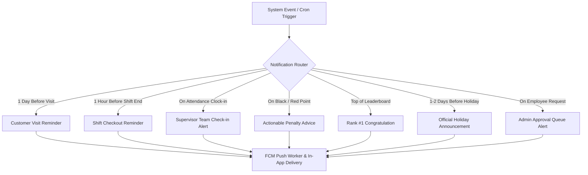
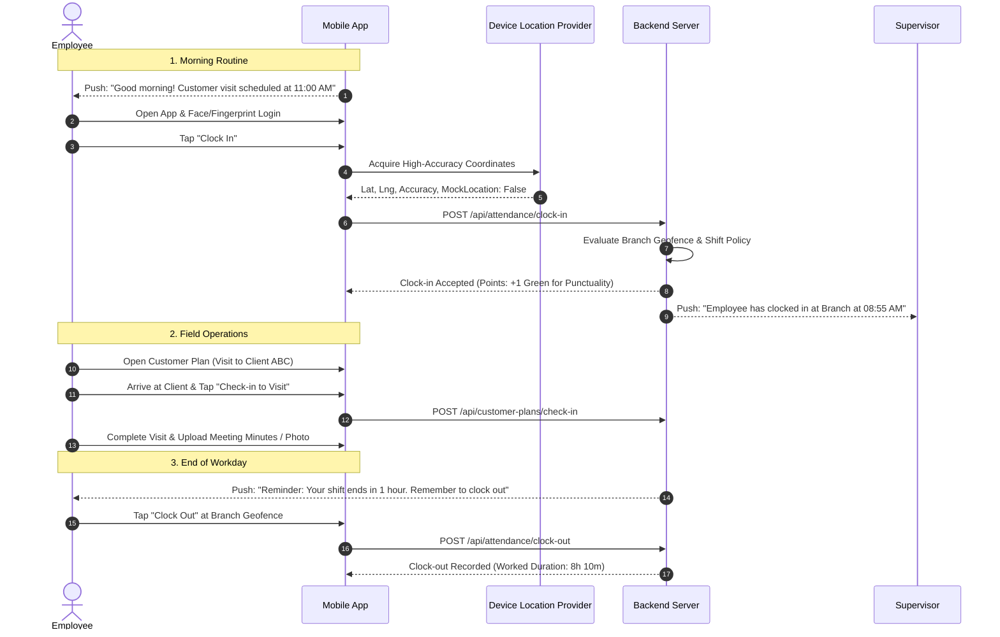

# Check Point HRM — Enterprise Business & System Documentation
> **Document Code:** `CP-BRD-2026`  
> **System Name:** Check Point Smart Workforce & Human Resource Management Platform  
> **Applicable Platforms:** Mobile Application (Flutter - Android / iOS), Web Admin Dashboard (React / Vite), API Backend (Node.js / Fastify / TypeScript / Prisma / PostgreSQL)  
> **Documentation Target:** Full Business Logic, Workflows, Domain Rules, and Operational Architecture.

---

## Table of Contents
1. [Executive Summary & Product Vision](#1-executive-summary--product-vision)
2. [Multi-Tenant & Multi-Persona Architecture](#2-multi-tenant--multi-persona-architecture)
3. [Identity, Device Binding & Anti-Fraud Security](#3-identity-device-binding--anti-fraud-security)
4. [Smart Attendance & Geofencing Engine](#4-smart-attendance--geofencing-engine)
5. [Leaves, Permissions & Absence Management](#5-leaves-permissions--absence-management)
6. [Field Operations & Customer Visit Management](#6-field-operations--customer-visit-management)
7. [Gamification & Behavioral Points System](#7-gamification--behavioral-points-system)
8. [Comprehensive Notification & Reminder Network](#8-comprehensive-notification--reminder-network)
9. [Workforce Policies, Shifts & Organizational Setup](#9-workforce-policies-shifts--organizational-setup)
10. [End-to-End Business Flowcharts](#10-end-to-end-business-flowcharts)

---

## 1. Executive Summary & Product Vision

**Check Point HRM** is a multi-tenant enterprise-grade Workforce Management and Smart Field Operations ecosystem. The platform serves modern enterprises requiring strict attendance verification, seamless multi-branch administration, intelligent field sales/service monitoring, and gamified employee engagement.

### Strategic Objectives:
1. **Zero-Fraud Attendance Verification:** Strict 4-way verification combining Hardware UUID binding, high-accuracy GPS geofencing (circular & polygonal boundary checks), Mock-Location detection, and Biometric verification.
2. **Dynamic Multi-Persona Operations:** Instant persona switching between Employee, Supervisor, and Administrator roles within the same mobile app without session termination.
3. **Field Sales & Client Tracking:** Enabling field agents and engineers to execute client visits against scheduled work plans with geofence check-ins, document uploads, and meeting outcome reports.
4. **Behavioral Gamification (Discipline Engine):** Automatic allocation of positive (Green) and penalty (Red, Black) points based on punctuality, attendance consistency, and policy adherence, coupled with an internal redemption store and badges.
5. **Proactive Real-Time Notification Network:** Intelligent push notification and reminder pipelines for shift departures, scheduled client visits, attendance alerts, approval queues, and team milestones.
6. **Enterprise ERP Sync:** Bi-directional synchronization with external enterprise systems (such as Odoo ERP) for attendance records, leaves, and official holidays.

---

## 2. Multi-Tenant & Multi-Persona Architecture

The system operates on an isolated multi-tenant data model where each organization belongs to a dedicated `Tenant` with its own configuration, localization, shifts, and policies.



### User Personas & Responsibility Matrix:

| Persona | Target Audience | Primary Responsibilities & Permissions |
|---|---|---|
| **Employee** | All staff (Office, Field, Remote, Contractors) | Self-attendance (Clock-in / Clock-out), Request submissions (Leaves, Short Permissions, Overtime, Remote Work, Corrections), Client visit check-ins, Task execution, Points summary, Badge tracking, Points redemption. |
| **Supervisor** | Team Leads, Branch Managers, Department Heads | Live team presence tracking, Clocking-in on behalf of field subordinates (`Team Attendance`), Level-1 approval for leaves, permissions, and overtime, Task assignment, Department work plan reviews. |
| **Administrator (Admin / HR)** | HR Executives, Operations Managers, Super Admins | Full organizational governance, Tenant configuration, Branch & geofence mapping, Shifts & policy definitions, Hardware device approvals, Account requests, Level-2 final approvals, System audit logs, Points catalog management. |
| **Site HR / Site Supervisor** | Dedicated on-site coordinators | Attendance verification restricted strictly within designated branch/site coordinates (Zone-Restricted login). |

---

## 3. Identity, Device Binding & Anti-Fraud Security

To prevent proxy clocking (buddy punching) and spoofing, Check Point enforces strict device-level hardware binding.



### Key Security Rules:
- **Single Hardware Binding:** An employee account can only register and clock-in from their approved mobile device hardware ID (`mobileId`).
- **Device Transfer Protocol:** If an employee changes their phone, the previous device must be deactivated, and the new device requires explicit Administrator approval.
- **Biometric Integration:** Users can authenticate locally via Fingerprint or Face ID (`local_auth`) without re-typing passwords after initial device authorization.
- **Brute-Force & Lockout:** Repeated failed login attempts (5 attempts) result in a temporary 15-minute account lockout with administrative audit logging.

---

## 4. Smart Attendance & Geofencing Engine

The attendance engine enforces policy compliance using multi-layered location and policy evaluation.

```mermaid
flowchart TD
    Start([Employee Clicks Clock In / Out]) --> LocationCheck[Query High-Accuracy GPS]
    LocationCheck --> MockCheck{Mock Location / Fake GPS Detected?}
    MockCheck -- Yes --> RejectMock[Reject Action & Flag Security Audit]
    MockCheck -- No --> SiteResolve{Assigned Workplace Type}
    
    SiteResolve -- Office / Branch --> BranchGeofence{Inside Branch Geofence?}
    SiteResolve -- Remote Work Approved --> RemoteCheck{Valid Remote Policy for Today?}
    SiteResolve -- Field / Client Visit --> ClientGeofence{Within Customer Location?}

    BranchGeofence -- No --> RejectOutside[Reject: Outside Authorized Site Area]
    BranchGeofence -- Yes --> PolicyCalc[Evaluate Policy Engine]
    
    RemoteCheck -- Yes --> PolicyCalc
    RemoteCheck -- No --> RejectOutside
    
    ClientGeofence -- Yes --> PolicyCalc
    ClientGeofence -- No --> RejectOutside

    PolicyCalc --> DeterminePunctuality{Check Policy Clock-In Time & Grace Minutes}
    DeterminePunctuality -- On Time / Early --> GrantGreen[Record Clock-In + Award Green Points]
    DeterminePunctuality -- Late (Within Grace) --> RecordStandard[Record Clock-In (Standard)]
    DeterminePunctuality -- Late (Exceeded Grace) --> ApplyRed[Record Clock-In + Deduct / Issue Red Points]
    
    GrantGreen --> NotifySupervisor[Notify Team Supervisor of Clock-In]
    ApplyRed --> NotifySupervisor
    RecordStandard --> NotifySupervisor
```

### Geofencing Models:
1. **Circular Geofence:** Latitude, Longitude, and radius in meters (`geofenceRadiusM`, default 150m).
2. **Polygon Geofence:** Closed geometric polygon with $N$ vertices evaluated via the Ray-Casting algorithm for irregularly shaped branches, warehouses, and construction sites.
3. **Attendance Dispute & Correction:** If an employee experiences connectivity failure or hardware issues, they can submit an `AttendanceCorrection` proposing revised clock-in/out times. Upon Admin approval, the day's attendance and points are recomputed retrospectively.

---

## 5. Leaves, Permissions & Absence Management

The platform supports comprehensive leave lifecycle management with multi-level approval hierarchies.



### Leave Categories:
1. **Annual / Sick / Casual Leaves:** Full-day or multi-day requests with automatic working day calculations, public holiday exclusions, and balance decrementing.
2. **Short Leaves / Hourly Permissions (مغادرات):** Hourly departures during the workday (maximum allowance per month defined by policy). Automatically cross-referenced with clock-out/clock-in gaps to prevent red penalty points.
3. **Automated Absence Detection:** Nightly automated background worker inspects scheduled working shifts. Employees missing clock-in without an approved leave or excuse are marked **Absent**, triggering an automatic **Black Point**.

---

## 6. Field Operations & Customer Visit Management

Designed specifically for field representatives, service technicians, and sales teams.



### Customer Plan Capabilities:
- Scheduled client visits with explicit date, time, and agenda.
- Customer location verification (latitude/longitude and geofence boundary).
- Attachment of meeting documentation, contracts, or inspection photos.
- Tracking of plan status: `Draft`, `Scheduled`, `In-Progress`, `Completed`, or `Follow-Up`.

---

## 7. Gamification & Behavioral Points System

To promote punctuality and organizational commitment, Check Point features an automated Behavioral Points Engine.

### 1. Point Categories:
- **Green Points (Positive / Reward):**
  - Earned through early check-in (before shift start), continuous attendance streaks (e.g., 5, 10, 20 consecutive days without tardiness), or administrative commendations.
  - Can be redeemed in the company reward store for monetary bonuses, gift cards, or merchandise.
- **Red Points (Tardiness / Infraction):**
  - Incurred for late arrivals exceeding policy grace minutes or unexcused early departures.
  - Can be counterbalanced by redeeming earned Green Points before monthly settlement.
- **Black Points (Severe Breach / Absence):**
  - Incurred for unexcused full-day absence.
  - Generates an immediate notification instructing the employee to file an excuse or formal leave request within 48 hours to avert salary deductions.

### 2. Gamification Milestones & Badges:
- **Badges:** `Falcon` (Early Bird Master), `Disciplined` (Zero Lateness Streak), `Committed` (Perfect Monthly Attendance), `Rescuer` (Redeemed points to resolve penalties).
- **Leaderboards:** Departmental and company-wide monthly leaderboards with automated recognition for the #1 ranked employee.

---

## 8. Comprehensive Notification & Reminder Network

The platform incorporates an event-driven and scheduled notification network delivering in-app updates and FCM push notifications.



### Event Catalog Breakdown:

| Event Type | Audience | Trigger Condition | Notification Message Context |
|---|---|---|---|
| `reminder.customer_visit` | Specific Employee | 24 hours prior to scheduled visit | Reminds employee of client name, meeting time, and agenda. |
| `reminder.shift_checkout` | Active Employee | 1 hour prior to policy clock-out time | Reminds employee to record checkout before leaving the work zone. |
| `attendance.team_checkin` | Team Supervisors & Branch Managers | Employee clocks in | Informs supervisor that their team member has arrived at site. |
| `points.black` | Subject Employee | Unexcused absence recorded | Instructs employee to submit a leave request or excuse to clear penalty. |
| `points.red` | Subject Employee | Late arrival or early departure | Instructs employee to submit a permission or attendance correction. |
| `points.green_pending` | Subject Employee | Pending green points in queue | Alerts employee of points awaiting manager confirmation. |
| `gamification.rank_first` | Subject Employee | Reaching #1 rank on team | Congratulates employee on holding the top position with current points. |
| `holiday.upcoming` | All Organization Employees | 1-2 days before official holiday | Announces upcoming public holiday and official holiday dates. |
| `holiday.rescheduled` | All Organization Employees | Admin shifts or alters holiday | Alerts workforce of updated holiday dates. |
| `overtime.created` | Approvers & Admins | Employee submits overtime request | Alerts management to review pending overtime hours. |
| `remote.created` | Approvers & Admins | Employee submits remote work request | Alerts management to review remote work justification. |
| `attendanceCorrection.created` | Approvers & Admins | Employee disputes clock in/out | Alerts management to review proposed attendance timestamps. |
| `accountRequest.created` | Admins | New user requests account | Alerts HR of new mobile registration awaiting provisioning. |
| `device.pending` | Admins | Employee logs in from new phone | Alerts IT/Admin to authorize hardware device transfer. |

---

## 9. Workforce Policies, Shifts & Organizational Setup

### 1. Organizational Hierarchy:
- **Tenant:** The enterprise account root.
- **Branches / Sites:** Physical geographical locations with assigned geofence boundaries (Circle / Polygon).
- **Departments:** Functional business units (e.g., Engineering, Sales, Human Resources).
- **Employees:** User profiles assigned to a department, branch, and direct supervisor.

### 2. Shift & Policy Configuration:
- **Fixed Shifts:** Definite start time (e.g., `09:00`) and end time (e.g., `17:00`).
- **Flexible Shifts:** Required daily duration (e.g., 8 hours) with floating arrival windows.
- **Grace Period (دقائق السماح):** Window permitting minor arrival delays without penalty (e.g., 15 minutes).
- **Early Arrival Threshold:** Period prior to shift start during which clock-ins are credited towards early arrival green points.
- **Night / Cross-Midnight Shifts:** Shifts traversing 00:00 midnight (e.g., `22:00` to `06:00`), keyed to the date on which the shift commenced.

---

## 10. End-to-End Business Flowcharts

### Complete Daily Employee Lifecycle:


---

*Check Point HRM Platform — Enterprise Business Architecture & Specification.*
